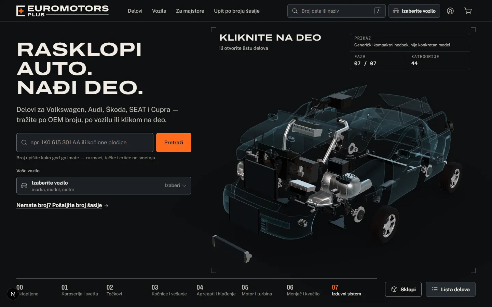
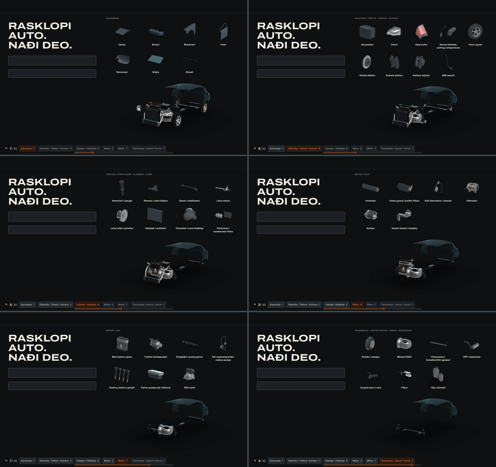
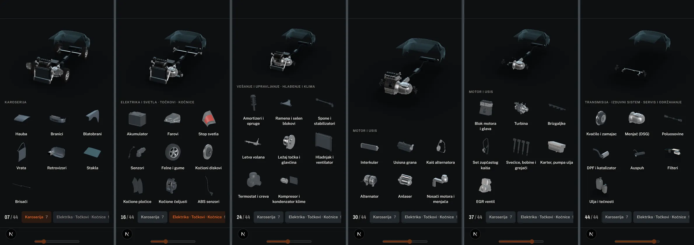

# Hero v2 — the car sets its parts down in a grid

> **Built in step 31 (2026-10-13): §18 says what was built, where it differs from this plan and what was measured.** The sections before it are the plan as written.
>
> Step 30 (2026-10-13). **Plan only: no production code changed.** Index: [docs/README.md](../README.md). Contract this plan amends when it is built: [3D-CONTRACT.md](../3D-CONTRACT.md) §F6–F9. Evidence: [`hero-v2/current/`](hero-v2/current/) (the hero as it is today) and [`hero-v2/lab/`](hero-v2/lab/) (a throwaway prototype on the real model, deleted after the captures).

The owner likes the idea and the behaviour of the 3D hero. He does not like its accessibility, its UX, or how hard the parts are to see. He wants the parts to leave the car on scroll and line up in a grid, each floating over its name with no frame of any kind, and the bottom bar turned into a nicer system navigator. Everything outside the hero is final.

## 0. Decisions in one table

| Topic | Decision | Why |
|---|---|---|
| Concept | „Radni sto“: the part is lifted out of the car and set down on the bench | One physical story for flight, grid and navigator |
| Grid unit | One slot per category, showing the same composition as the category's thumbnail | Whole categories in a slot were unreadable in the prototype (§16) |
| Paging | Six pages of whole systems, at most 9 slots; earlier pages leave | 42 slots cannot be read at once at 390 or 1440 px |
| Navigator | Ten chips, the catalog systems, clustered by page | The same systems as `/delovi/<system>`; each has one page |
| Layout | Grid **above** the car from 1024 px, **below** it on phones | On each width the grid takes the space the car frees when it shrinks about its poster anchor (§16) |
| Rendering | The real meshes, moved to camera-space slots in the same scene and pass | Only this shows the flight; no extra passes or draw calls |
| Readability | A per-category `dock` uniform: solid primer tone for ghost-glass panels, an exposure floor for dark parts | Both vanish in a slot without it (§16) |
| Car shrink | Camera dolly, never a smaller projection frame | Keeps every slot near the optical axis (§6.5) |
| Labels | Real links in a CSS grid; the 3D follows the cached slot rectangles | No per-frame layout reads or label writes; one structure for 3D, fallback and screen reader |
| Scroll | 300vh desktop (today 320), 240vh phones (today 200); no snap | One wheel gesture or one swipe per page (§13.2) |
| Fallback | Same pages with thumbnail images in the slots | Reduced motion, low tier, loading and context loss share one path |
| Counter | „Pronađeno 23/44“, honest: 42 from the car, 2 from the shelf | The two service categories have no mesh |

## 1. Critique of the current hero

Method: this repo's dev build on port 3210, Chromium with the real GPU (ANGLE D3D11), 1440×900 at DPR 1 (high tier) and 390×844 at DPR 2 (mid tier). Every stage was reached by real scrolling and by the `window.__sklop3d` hook, and captured. Numbers below are measured in the page or computed from the manifest cameras; nothing is estimated. Two independent passes ran beside it, as the impeccable critique playbook asks: a design review (Nielsen score **27 / 40**) and the detector (0 findings in `components/three`; the one in-page hit inside the hero is on the closed search dropdown, a false positive). axe reports 0 violations in the hero.

| | Desktop 1440×900 | Phone 390×844 |
|---|---|---|
| Sticky frame | 1440 × 824 px | 390 × 720 px (stage box 390 × 488) |
| Scroll distance of the explode | 2880 px (320vh) | 1688 px (200vh) |
| Largest instance of a category on screen, end state — median | 91 px | 45 px |
| Categories under 44 px | 6 of 42 | 19 of 42 |
| Smallest | 25 px (kočione pločice) | 12 px (kočione pločice) |
| Tab stops in the hero | 14 | 16 |
| Categories in the accessibility tree | 0 of 44 | 0 of 44 |
| Stage changes announced | 0 | 0 |

### 1.1 Visibility of the parts

- **The end state is a dark cluster, not an exploded view.** At 1440 px 14 of 42 categories are under 64 px; on a phone 19 are under the 44 px touch minimum and 8 are under 24 px (brake pads 12, EGR valve 13, wheel bearing 16, ABS sensors 18). [`desktop-9-end`](hero-v2/current/desktop-9-end.webp), [`mobile-9-end`](hero-v2/current/mobile-9-end.webp).
- **Dark parts on a dark field.** Engine, radiator, battery and tyres render near black on `#0D0F11`. The ghost shell stays in front of them for the whole scroll.
- **Body panels are the weakest parts.** Hood, doors, bumpers, fenders and glass are ghost glass at 10–22 % alpha; once they move off the car they are an outline at best.
- **The camera pulls back as the car comes apart**, so parts shrink exactly when they become separate: the median size drops from 132 px (assembled) to 91 px (exploded) on desktop, and from 78 px to 45 px on a phone.
- **Parts have no names until hover or tap**, and only one name shows at a time.
- **What works:** a selected part. The focus glide isolates it at a readable size with its name and the panel beside it ([`mobile-selected`](hero-v2/current/mobile-selected.webp)). v2 keeps this.

### 1.2 Legibility

- Contrast is not the problem: every text in the hero measures 6.6:1 or better.
- The smallest text is 11 px mono caps (stage counts „03 · 9 KATEGORIJA · 31 DEO“, title-block keys).
- Below 1280 px, on phones and with the drawer open, the stage index is bare numerals 00–07.
- The hover callout covers the title block ([`desktop-hover`](hero-v2/current/desktop-hover.webp)).
- On phones the stage caption sits over the moving car.
- Counts disagree: the caption says „42 kategorije“, the title block „44“, the callout counts „artikla“ and the caption counts „delova“ (meshes).

### 1.3 Focus and keyboard

- Focus is visible on every stop and returns correctly from the dialog and the panel.
- **No part can be reached from the keyboard.** The only path is „Lista delova“, the 14th tab stop of the hero, behind eight stage buttons; the dialog then has 44 more stops and no filter.
- A click that misses a part clears the selection (`components/three/canvas/usePointerPicking.ts:79`).

### 1.4 Screen reader

- The stage is one `role="img"` with one sentence. Its 44 categories exist only inside the dialog.
- The live region says „Učitava se 3D prikaz“ and nothing after: not when the model is ready, not when a stage changes (log of the whole walk: empty).
- Stage buttons have an `aria-label` that differs from the visible label (`StageStrip.tsx:110` and `:134`, WCAG 2.5.3).
- No skip link past the hero.
- Under reduced motion the phone caption still says „Skrolujte…“ although there is no track.

### 1.5 Scroll length

- The hero is 3704 px of a 11 987 px page on desktop: 31 % of the home page before the first section heading.
- Scroll is not spent where the content is. In 100 px wheel notches: stage 3 (31 parts, 9 categories) gets 4 notches, stage 7 with its hold (4 parts) gets 7. The last 8 % is a hold.
- On a phone, 300 px swipes cross the track in 10 swipes, and **stages 2 and 6 are never the current stage at any stop** — the grouped mobile windows pass inside one swipe.
- Desktop never says that scrolling takes the car apart; „Kliknite na deo“ appears only at 92 %.

### 1.6 Mobile

- First screen: the copy comes first, so 344 of the stage's 488 px are visible; on a first visit the cookie banner covers that part too ([`mobile-0-first-visit`](hero-v2/current/mobile-0-first-visit.webp)).
- Picking is an exact raycast on parts that are 12–45 px; there is no touch preview.
- Two indices for the same thing: eight numerals (45 × 44 px each) and a previous/next stepper, 12 controls in the frame above the four-item bottom bar.
- Low tier and loading: the exploded poster still says „Kliknite na deo“ over a picture that cannot be clicked ([`desktop-low-end`](hero-v2/current/desktop-low-end.webp)).

### 1.7 Found outside the hero (not fixed here)

Dismissing the cookie banner with „Odbij sve“ scrolls the page to the very bottom (desktop: scrollY 0 → 11 087, the maximum; phone the same), with focus on `<main>`. Reproduced with a raw pointer click and a raw touch on the dev build; not checked on a production build. `ConsentBanner.tsx:138` already passes `preventScroll: true`, so the cause is elsewhere. A first-time visitor who declines cookies lands on the footer.

## 2. Concept — „radni sto“

A mechanic lifts a part out of the car and sets it down on the bench. That is the whole motion: the car stays where it is as the source and gets emptier; the bench shows one group of parts at a time, each over its name; a finished group goes into the navigator, which keeps the count.

It is a catalog navigator first. Every slot is a link to a category, every chip a jump to a system, and the hero ends on the two actions the shop wants: choose the vehicle, or open the catalog.

## 3. Grid unit

**One slot per category.** All 42 categories with a mesh can be shown (91 part nodes). Every instance of a category flies to the category's slot.

**The slot shows what the thumbnail shows.** `3d/blender/config/thumbs.py` already defines, per category, which instances make the picture (one representative, or a kit such as block + head, or a `row` such as compressor + condenser) and from which camera. The slot uses the same nodes and the same camera angle. The other instances arrive with the representative and tuck behind it, scaling to zero over the last 30 % of their flight: four discs leave four corners and become one „Kočioni diskovi“.

- The prototype first tried whole categories (kits, fanned stacks). Scattered sets shrank to nothing and stacks of small complex parts were noise ([`mesh-vs-image-p3`](hero-v2/lab/mesh-vs-image-p3.webp): meshes on top, thumbnails below).
- With the thumbnail composition every category renders at 97–106 px on desktop and 62–72 px on a phone (§16).
- A docked mesh and its fallback image are then the same picture, so the per-slot crossfade in §12 does not jump.

**Categories without a mesh.** `filteri` and `ulja-tecnosti` (system `servis`) have a thumbnail and no geometry. They are image slots on the last page under the heading „Servis i održavanje“; they arrive with the block reveal, not by flight. The counter reaches 44 only with them.

**`senzori`** has three instances that leave the car in three manifest stages. It docks as one slot with its system, on page 2.

## 4. Pages and choreography

### 4.1 Pages

42 labelled slots cannot be read at once (at 390 px they would be 12-px parts again). The grid shows one page; pages are runs of whole catalog systems in disassembly order, at most 9 slots.

| Page | Systems | Slots |
|---|---|---|
| 1 | Karoserija 7 | 7 |
| 2 | Elektrika i svetla 4 · Točkovi 1 · Kočnice 4 | 9 |
| 3 | Vešanje i upravljanje 5 · Hlađenje i klima 3 | 8 |
| 4 | Motor i usis — the six categories of manifest stage 4 | 6 |
| 5 | Motor i usis — the seven categories of manifest stage 5 | 7 |
| 6 | Transmisija 3 · Izduvni sistem 2 · Servis i održavanje 2 | 7 |

- A category's page is a property of the category, defined in one pure module (a new `pages.ts` in `lib/three/`); the same six pages serve desktop and phones.
- Rejected: one page per manifest stage. Systems would then point at up to four pages (`elektrika-i-svetla` spans stages 1, 4, 5, 7), `senzori` would have nowhere to wait, and the 10-slot stage needs sub-pages on phones.
- Rejected: a continuous ribbon. Every label would be a moving click target.
- The manifest keeps its stages, directions, distances and orders; nothing is re-exported. Three instances leave earlier than their manifest stage (the battery and two sensors). The Blender collision audit covers the old explode only, so the implementation checks the new flight paths by scrubbing (§14).

### 4.2 The clock

Scroll progress `p` in 0…1 is the only clock. Each part's pose is a pure function of `p`, the camera and the slot rectangles, with no stored state, so scrolling back plays the same frames in reverse.

- `p` 0–0.06: the assembled car; the car shrinks into its band over 0.01–0.06.
- `p` 0.06–0.94: six pages of equal length (0.1467 each).
- `p` 0.94–1: the end state.

Inside a page (`u` = 0…1):

| `u` | What happens |
|---|---|
| 0–0.12 | The previous page leaves: each part shrinks to zero toward its chip, its name cuts out, then `visible = false` |
| 0–0.55 | Arrivals. Each part's own flight takes 0.30 of the page; starts are staggered across 0.25 by slot order |
| 0.55–1 | Rest plateau: nothing moves but the float. The chip jumps to `u` = 0.8 |

One part's flight (`t` = 0…1), `power2.inOut` on every leg, 0 % overshoot:

1. **Lift** (`t` 0–0.35): along its manifest `explode.dir`, capped at 0.3 m.
2. **Carry** (`t` 0.2–1): from the lifted position to the slot on an arc lifted by 10 % of the path toward camera-up; scale and rotation blend to the slot values.
3. **Seat** (last 10 %): the float fades in, the `dock` uniform reaches 1, the name arrives.

**Float** is time-based, zero-mean and multiplied by the dock factor, so it never disturbs the scroll clock: bob ±3 px (±2 px on phones), pendulum yaw ±10° (never a full turn: a 2.4 m exhaust is unreadable end-on), period 4–6 s and 7–11 s, phase hashed from the slug.

**The car** dims its shell as page 1 leaves, and its contact shadow fades with the share of parts gone. The camera keeps the hero pose (no orbit to an exploded pose: there is no cloud to frame any more).

## 5. Layout

**Rule: the grid takes the space the car frees when it shrinks about its poster anchor.** The car never travels across the frame.

- From 1024 px the poster is anchored bottom-right, so the grid is **above** the car.
- On phones the stage box is at the top of the frame, so the grid is **below** it.
- Tested both ways at both widths: [`flight-desktop-above`](hero-v2/lab/flight-desktop-above.webp), [`flight-desktop-below`](hero-v2/lab/flight-desktop-below.webp), [`flight-mobile-below`](hero-v2/lab/flight-mobile-below.webp), [`flight-mobile-above`](hero-v2/lab/flight-mobile-above.webp). The opposite choice moves the car about a third of the frame during the intro and, on desktop, sends parts down across the car when most explode directions point up.

| | Desktop 1440×900 | Laptop 1366×768 | Phone 390×844 | Phone 390×664 |
|---|---|---|---|---|
| Grid region | cols 6–12, 774 px wide, top of the frame | the same, 731 px | full width under the car | the same |
| Columns × rows | 5 × 2 (4 × 2 for ≤ 8 slots) | 5 × 2 / 4 × 2 | 3 × 3 | 3 × 3 |
| Mesh cell | 124 px | 124 px | 80 px | 80 px |
| Part on screen (measured) | 97–106 px | 97–104 px | 62–72 px | 62–74 px |
| Label | `type-caption` 13 px, ≤ 2 lines | the same | the same, 10 short forms | the same |
| Car band | 356–374 px | 224–242 px | 220 px (fixed to the 3-row grid) | car becomes a 96 px miniature beside the page heading |

- The band is fixed per breakpoint, so the car does not resize between pages (the prototype let it flex; that is not kept).
- At `p` = 0 the frame is exactly today's on every width: poster parity, the 4:5 phone stage box (D279) and its e2e test stay.
- Copy column (cols 1–5) is untouched: the search field and the vehicle field stay beside the grid for the whole scroll.
- 360×640 was not verified: the 80 px cell does not fit three rows there. Rule to implement and test: the cell steps down to 64 px when three rows leave less than 96 px for the car.

## 6. Rendering

### 6.1 Approach

**The real meshes, moved to camera-space slots in the same scene and the same render pass.**

Rejected: one viewport or scissor region per slot. A region cannot show a part crossing its edge, so the flight would still need the full camera-space solve for the hand-off; it adds about nine render calls per frame, clips the bob, and the lighting pops at the swap.

### 6.2 What changes in the code

| Where | Change |
|---|---|
| `canvas/controller.ts:165-187` | The GSAP explode timeline is replaced by a pose evaluator that writes position, quaternion and scale per part and frame |
| `controller.ts:278-285` `categoryBox` | Uses `localBox.applyMatrix4(node.matrixWorld)` instead of a translation only |
| `controller.ts:447` `anchorOf` | Uses `node.localToWorld`; new `originAnchorOf(slug)` projects the static pivot for the origin leader |
| `controller.ts:295` `computeFocus` | Skipped while the category's dock factor is above 0.5 |
| `controller.ts:421` `pick` | Ignores parts with a dock factor above 0.1: the DOM link covers them |
| `controller.ts:218` shadow | Holds the assembled contact shadow and fades it with the share of parts gone |
| `HeroStage.tsx:519-555` | The canvas moves from the stage box to the whole sticky frame; the `role="img"` box and the poster stay where they are |
| `Layout` | Gains the stage rectangle inside the canvas; `viewOffsetFor` already takes an independent canvas size |
| Overlay pass, BVH picking | Unaffected (layers; mesh-local raycast) |

### 6.3 The `dock` uniform

Materials are already cloned per category with `hover`, `select` and `dim` uniforms, so one more uniform costs no new shader program.

- **Ghost-glass panels** (`mat_body_xray`, `mat_glass_xray`). In a slot the glass look is an outline; a dark primer (`#2F3337`) is barely better; a mid primer grey (`#59626C`) reads as a part ([`xray-desktop`](hero-v2/lab/xray-desktop.webp): glass, dark primer, mid primer, mid primer with fill). `dock` blends the base alpha to about 0.9 and the tint to the primer tone, shaded by a view-space half-Lambert. Aftermarket body panels ship in primer, so the look is truthful. Glass keeps a translucent rim tone.
- **Dark parts.** Brake pads, ABS sensors, radiator, thermostat and wipers are black on black without help ([`lift-desktop`](hero-v2/lab/lift-desktop.webp): no lift, 0.07, 0.14). `dock` adds an exposure floor, the web counterpart of the floor the thumbnails got in D241, injected at the hook the highlight already uses (`materials.ts:176-183`).
- No new lights. The key light already comes from the camera's side (azimuth 35°; the hero camera sits at 36°), so a part turned to face the camera is lit from the front.

### 6.4 Orientation and scale

- **Orientation** comes from the thumbnail camera (default azimuth 35°, elevation 20°, 21 overrides in `thumbs.py`), mirrored into a new `heroSlots.ts` in `constants/` with a parity test. Not from the manifest's `focus.dir`: 15 categories sit at its distance clamp at 50–58° elevation, which shows a disc nearly edge-on.
- The rotation is built from each slot's own view ray, and formation offsets are laid out in the slot's own basis. The prototype first used the camera's axes: stacks then ran up or down the screen depending on where the slot sat.
- **Scale**: fit the composition's projected extents to 78 % of the mesh cell. With one rule the 0.10 m EGR valve and the 1.8 m bumper both land at 97–106 px.

### 6.5 The car shrinks by dolly

The first prototype shrank the projection frame. On a short phone the car band was 40 px, the frame's focal length in pixels collapsed, slots ended up many image heights off the optical axis, and docked parts stretched to 473 px ([`sizes-short`](hero-v2/lab/sizes-short.webp) shows the fixed result). The rule that came out of it:

- The contain frame keeps its poster size; the camera backs away along its view line (log-space dolly) and the view offset places the car in its band.
- Measured maximum off-axis angle of a slot: 22.7° at 1440, 21.3° at 1366×768, 28.8° at 390×844, 31.5° at 390×664.
- Target: 20°. Phones need a longer lens while docked (blend the 31° field of view toward about 20° with the dolly). Not yet verified; it is a unit-tested bound in `slots.ts`.

### 6.6 Budgets

| | Budget | Prototype |
|---|---|---|
| Draw calls, triangles | Never above today's peak at `p` = 0 | Fall page by page: 222 → 202 → 132 → 85 → 62 → 32 calls, 354k → 60k triangles (renderer counts, high tier) |
| Textures, GLB bytes | +0 | +0 |
| Lazy 3D chunk | ≤ +10 KB gzip (291 KB of the 350 KB budget today) | not measured |
| Origin ghost on hover | ≤ 16 extra draw calls while it shows | not built |

## 7. Labels

- The grid is a CSS grid of real links inside the sticky frame. The canvas and the grid share that frame, so slot rectangles do not change with scroll.
- Rectangles are read once per resize (ResizeObserver) and cached. Each frame the scene unprojects the cached centres through the live camera. There are no per-frame layout reads and no per-frame label writes: the part bobs, the name stays still.
- This inverts the brief's suggestion (project 3D positions to DOM in one rAF write). The reason: one structure is then the 3D layout, the fallback image grid and the accessible list, and the browser does the responsive layout. Measured drift between a docked part's projected centre and its cell centre: at most 4 px on desktop, 3 px on phones.
- Text: `labelSr`, `type-caption` (13 px), `text-ink-1`, centred, at most two lines. No box, border or background; the link keeps `rounded-sm` and the focus ring.
- At 390 px ten names need a short form. Each is a leading substring of `labelSr` (WCAG 2.5.3); the full name is the accessible name. A unit test enforces the substring rule.
- A name is not in the layout until its part seats (the flight sheets show why: names under flying parts read as clutter). It then arrives word by word through `splitWords` / `restoreWords`. The grid root is `data-reveal="off"`.
- A page heading sits above the grid: the systems of the page in `type-label` (it replaces `StageCaption`'s place; the component and its replay logic are reused).

## 8. Interaction

| Action | Result |
|---|---|
| Hover or focus on a slot | The docked part takes the hover tint; a ghost of the category appears at its origin on the car (all instances, shared geometry, overlay layer); a 1 px leader line joins slot and origin |
| Click or Enter on a slot | `/delovi/<slug>` with the selected vehicle's parameters (`categoryHref`, as the panel footer does today) |
| Click on a part still on the car | PartPanel, as today (`?deo=`, focus glide) |
| Panel open | The grid is `inert` and dimmed; the float stops; the navigator reflows left of the drawer (D280) |
| Chip | Scrolls to the rest point of that system's page |
| Deep link `/?deo=<slug>` | Goes to the category's page rest point, then opens the panel |
| A missed click on the car | No longer clears a selection; only Escape or the close button does |

## 9. Gamification

Kept to what a parts shop can carry: progress you can see, a seat you can feel, an end with a next step.

- **Counter** „Pronađeno 23/44“ in `type-numeral-s`, in the title block on desktop and in the navigator on phones. It counts seated slots.
- **Seat beat**: on the frame a part seats, its tick mark draws under the cell (180 ms), the name arrives and the counter steps. No bounce.
- **Chips** show found/total while their page is active and a check when done.
- **End state** „Ceo auto rastavljen“: the empty shell, 44/44, and three actions — „Izaberite vozilo“ (primary, opens the vehicle picker), „Svi delovi“ (secondary, `/delovi`), „Sklopi auto“ (quiet, scrolls back).
- No sound, no confetti, no points, nothing stored between visits.

## 10. System navigator

One row at the bottom of the frame; it replaces `StageStrip` and `StageLegend`.

- **Content**: counter · ten system chips in five clusters · „Lista delova“. Clusters follow the pages: [Karoserija] [Elektrika · Točkovi · Kočnice] [Vešanje · Hlađenje] [Motor] [Transmisija · Izduv · Servis]. „Motor“ covers pages 4 and 5 and its hairline has two segments.
- **A chip** shows the short system name and its count; a shared hairline under the cluster fills with the page's progress.
- **States**: next (surface-2, ink-3), active (accent-subtle, accent — the only orange in the region), done (surface-3, ink-2, check).
- **Shape**: filled, `rounded-sm`, 40 px with a fine pointer, 44 px on touch; no outlines (one outline per region belongs to „Lista delova“).
- **Phones**: one `scroll-fade-x` row that keeps the active cluster centred; the previous/next stepper and the numeral legend are removed.
- **Keyboard**: one tab stop with a roving tabindex; Left/Right move, Home/End jump, Enter or Space activates.
- **Names**: the visible text is the accessible name's start („Kočnice, 4 kategorije, prikazano“); the active cluster's list item carries `aria-current="step"`.

## 11. Accessibility

- **The list is the grid.** Six server-rendered lists (one per page) with a heading per system and 44 links. The active page is laid out as the grid; the others are clipped with `sr-only`, never `opacity: 0`, so they stay in the accessibility tree and pass the hidden-copy check in `foundation.spec.ts`.
- The lists are siblings of the `role="img"` car box, not children (children of `img` are presentational). The car box keeps a shorter label; the canvas stays `aria-hidden`.
- **Tab order**: copy column → „Preskoči 3D prikaz“ (to `#systems-title`, styled like `SkipLink`) → navigator (one stop) → the active page's links → end actions. Links of inactive pages have `tabindex="-1"`.
- **Focus sync**: focusing any slot link, by Tab or by a screen reader, activates its page with the instant scroll path and lights the origin on the car.
- **Announcements**: the existing polite status region says the page once progress has been still for 400 ms („Kočnice, Točkovi, Elektrika i svetla — 9 kategorija“), never while scrubbing. It also says when the 3D is ready, which today it never does.
- **Touch**: every slot link is at least 44 px in both directions (cell 80 px plus label).
- **Reduced motion and the other fallbacks**: §12.

## 12. Fallbacks

A slot has two modes: `mesh` (transparent cell, the canvas draws the part) and `image` (`next/image` of the thumbnail at slot size). Images mount only in `image` mode and only for the current and outgoing page, never in the server HTML and never while the 3D runs.

| Situation | Track | Car | Slots |
|---|---|---|---|
| `prefers-reduced-motion` | None; chips cut between pages | Canvas or poster, static; docked categories simply hidden | `image` |
| Low tier, no WebGL | Same track | Assembled poster, moved to its band by the same transform | `image` |
| Model still downloading after the user scrolled | Same track | Poster | `image`, then a per-slot crossfade when the canvas is ready |
| Context lost mid-scroll | Same track | Poster returns | `image` |
| No JavaScript | None | Poster | The lists stay clipped; „Delovi po sistemima“ below the hero is the visible equivalent, as today |

- Everything is absolutely positioned inside the reserved frame, so no mode change shifts layout.
- The exploded poster and `car-shadow-exploded.webp` are no longer used. An optional Blender render of the stripped shell would improve the low-tier end state; it is not required.
- „Kliknite na deo“ is never shown over a poster.

## 13. Performance

### 13.1 Budgets

| Metric | Budget | Today |
|---|---|---|
| LCP | Unchanged element and preload; the grid adds no image above the fold | 2.29 s (poster / headline) |
| Home TBT (mobile, applied throttling, 5 runs) | < 150 ms | 86 ms |
| Lighthouse performance / accessibility / SEO | ≥ 90 / 95 / 95 | 96 / 100 / 100 |
| CLS | ≤ 0.05 | 0.001 |
| First-load JS | Not above today's 311 KB (the 180 KB budget was missed before this work) | 311 KB |
| Frame time, high tier | Median ≤ 16.7 ms, p95 ≤ 25 ms through the track and while floating | Prototype, this PC's GPU: 16.7 / 16.7 ms, 0 frames over 20 ms in 8 s |
| Frame time, mid tier | Float on every second frame (30 fps); scroll at ≥ 30 fps | Prototype on `car-lite.glb`, this PC's GPU: 16.7 ms. **No phone was measured.** |

- `tests/lighthouse/run.mjs` gates home at performance 0.85 and TBT 200 ms. The implementation step tightens that row to 0.90 and 150 ms.
- The render loop stays `frameloop="demand"`. While something floats, the frame callback invalidates itself; R3F ignores that under `never`, so the off-screen pause is unchanged.
- The float eases out after 6 s without input and the loop stops; it also stops when the tab is hidden, the hero is off-screen, or a part is selected. Today the hero costs no GPU at rest and must stay that way.
- The 30 fps throttle must not trip adaptive DPR (`HeroCanvas.tsx:361-378` treats gaps over 22 ms as slow): only unthrottled frames count.
- Slot tables and origin ghosts are built in idle slices (`runInIdleSlices`).

### 13.2 Scroll length

**300vh from 1024 px, 240vh below.** No snap (D34).

- At 1440×900 a page is 396 px: four wheel notches, of which the plateau is 178 px.
- At 390×844 a page is 297 px: one ordinary swipe per page, where today one swipe skips whole stages.
- Desktop gets shorter than today (320vh) while showing 44 named parts instead of eight captions. Phones get 40vh longer; that is the price of six readable pages.
- The design review recommended about 160vh and 100vh. That is two to three pages per swipe on a phone, or pages of 13–20 slots, which fails the two-line label at 390 px. The exits are the answer instead: the skip link, the chips, „Lista delova“, and the search field that never leaves the frame on desktop.

## 14. Test plan

| Point | Check |
|---|---|
| Every category on exactly one page, ≤ 9 per page, disassembly order | New `pages.test.ts` in `tests/unit/three/` |
| Pose is a pure function of progress; reverses exactly | Unit: same `p` → same pose after any sequence; monotone dock factor |
| Slot scale | Unit: all 42 compositions land within ±8 % of the target size for the reference rectangles |
| Slots near the optical axis | Unit: maximum off-axis angle ≤ 20° at 1440×900, 1366×768, 390×844, 390×664 |
| Thumbnail-camera table | Parity test against `3d/blender/config/thumbs.py` |
| Short labels | Unit: each is a leading substring of `labelSr` |
| Poster parity at `p` = 0 | `tests/unit/three/camera.test.ts` (kept) and `scripts/qa/hero-parity.mjs` at 390, 768, 1440 |
| Grid readable at both widths | e2e: at each page rest, every label ≤ 2 lines and every docked part ≥ 60 px (test hook reports projected sizes) |
| Part ↔ name drift | e2e: hook reports the largest centre error; ≤ 4 px after a resize, a font load and a drawer open/close |
| Flight paths | Scrub capture of every page at 12 steps, both widths, looked at once; no part crosses the copy column |
| Click on a slot | e2e: navigates to `/delovi/<slug>` with the vehicle parameters |
| Click on the car | e2e: panel opens, `?deo=` set, Escape returns focus (kept from `hero-3d.spec.ts`) |
| Hover and focus | e2e: origin ghost and leader appear for the focused slot |
| Navigator | e2e: one tab stop, arrow keys, each chip lands on its page; counts sum to 44 |
| Keyboard walk | e2e: Tab order as §11; a visible ring on every stop; the skip link lands on `#systems-title` |
| Screen reader | e2e: `ariaSnapshot` of the hero contains six lists and 44 links; the status region says one page after a jump and nothing during a scrub |
| Reduced motion | e2e: no track, no canvas transform between pages, slots are images, chips switch pages |
| Low tier, loading, context loss | e2e with `?3d=low`, a throttled model request and a forced context loss: image slots, no layout shift |
| No thumbnails while 3D runs | e2e: zero requests to `/images/parts/` after `ready` |
| axe | 0 violations with a page docked and with the panel open |
| Site rules | `corners.spec.ts`, `reveal-routes.spec.ts`, `foundation.spec.ts`, `rebrand.spec.ts`, `security.spec.ts`, `seo.spec.ts` stay green |
| Frame time | `scripts/qa/hero-frames.mjs --gpu` and at 4× CPU through the track, plus 60 s of float; one real mid-range phone |
| Budgets | `tests/lighthouse/run.mjs --runs 5`, `lh-compare.mjs` old against new, `hero-bundle.mjs` |
| Screens | `scripts/qa/ui-boost/shots.mjs --only=home` at 390 and 1440, reviewed |

`tests/e2e/hero-3d.spec.ts` is rewritten around these; `tests/unit/three/explode.test.ts` loses its stage-window cases to `pages.test.ts`.

## 15. Implementation plan (next step)

In order; each step can be verified on its own, and production behaviour changes only from step 6.

1. New `pages.ts` in `lib/three/` and its tests: page membership, windows, rest points.
2. New `heroSlots.ts` in `constants/` (thumbnail nodes and camera angles, parity test) and new `slots.ts` in `lib/three/` (unproject, composition, fit scale, arc, float, off-axis bound).
3. New `poses.ts` in `components/three/canvas/`: the pose evaluator, not yet imported by production code; unit tests for reversal.
4. `materials.ts`: `dock` in `HighlightUniforms`; primer and exposure floor.
5. Serbian strings in `lib/i18n/sr/hero.ts`: short system names, short labels, counter, page announcements, end state.
6. `controller.ts`: timeline out, evaluator in; world-matrix box and anchor; pick filter; focus guard; stage rectangle in a full-frame canvas; dolly; shadow.
7. `HeroCanvas.tsx`: self-invalidation while floating, mid-tier throttle, DPR fix, origin ghost.
8. `HeroGrid.tsx` (server lists plus a lazy client part) and `SystemNav.tsx`; store fields for page, slot mode and focused slot.
9. `HeroStage.tsx`: canvas to the frame, page publishing, `revealCategory` → page, fallback modes; counter in `TitleBlock`; page heading; end state.
10. `globals.css` track heights (300vh / 240vh); skip link; keyboard, focus sync, live region.
11. Tests of §14; contract F6–F9 and DESIGN-SYSTEM §7 updated; Lighthouse gate tightened.
12. Frame, Lighthouse and bundle gates; screenshots at 390 and 1440; PROGRESS and DECISIONS.

No Blender work and no manifest change is required.

## 16. What the prototype settled

A scratch page loaded the real GLBs through `loadCarScene` and docked one page of parts into a DOM grid. It was driven by Playwright and deleted afterwards.

| Question | Answer | Evidence |
|---|---|---|
| Grid above or below the car | Above from 1024 px, below on phones: the side the car frees about its anchor | [`flight-desktop-above`](hero-v2/lab/flight-desktop-above.webp), [`flight-mobile-below`](hero-v2/lab/flight-mobile-below.webp) and their opposites |
| Whole category or one composition per slot | The thumbnail's composition | [`mesh-vs-image-p2`](hero-v2/lab/mesh-vs-image-p2.webp), [`mesh-vs-image-p3`](hero-v2/lab/mesh-vs-image-p3.webp) |
| Do docked glass panels read | Not as glass, not as dark primer; yes as mid primer grey | [`xray-desktop`](hero-v2/lab/xray-desktop.webp), [`xray-mobile`](hero-v2/lab/xray-mobile.webp) |
| Do dark parts read | Only with an exposure lift | [`lift-desktop`](hero-v2/lab/lift-desktop.webp) |
| One scale rule for tiny and large parts | Yes: 97–106 px at 1440, 62–72 px at 390, all 42 | [`sizes-desktop`](hero-v2/lab/sizes-desktop.webp), [`sizes-mobile`](hero-v2/lab/sizes-mobile.webp) |
| Labels in two lines | Yes at 1440 (4 need two lines) and at 390 with 10 short forms | the same sheets |
| Shrinking the car | By dolly; shrinking the projection frame breaks short screens | [`sizes-short`](hero-v2/lab/sizes-short.webp) |
| 1366×768 | Works; the car band is 224 px | [`sizes-laptop`](hero-v2/lab/sizes-laptop.webp) |
| Cost of a continuous float | 60 fps on both models on this PC's GPU, also at 4× CPU throttle | §13.1 |

The four flight sheets, the X-ray, lift and mesh-against-thumbnail sheets were captured before the switch to the dolly (§6.5) and, for the flight sheets, with every name visible; they are evidence for their own question only. The `sizes-*` sheets are the final state of the prototype.

Not settled by the prototype: a real phone's frame time and heat; edge shimmer during the yaw on the mid tier (no MSAA); the phone lens change of §6.5; 360×640; the origin ghost and the leader line; the look of low-triangle parts in motion (they hold up in stills at these sizes).

## 17. Open questions for the owner

Written in Serbian in [HUMAN-TODO.md](../HUMAN-TODO.md) §19.

1. Grid above the car on a computer, below it on a phone.
2. Ten system chips instead of eight stage numbers.
3. A click on a part in the grid opens the category page; a click on a part on the car still opens the panel.
4. Body panels shown in grey primer in the grid, not as glass.
5. Scroll length: slightly shorter on a computer, somewhat longer on a phone.
6. Wording: „Pronađeno 23/44“, „Ceo auto rastavljen“.

## 18. As built (step 31)

Built in seven blocks, one commit each — `330b641` layout and the make-room move · `ccd214a` the grid · `4f42178` labels · `300f957` interaction · `a232b4b` navigator · `97872ab` accessibility and fallbacks · `57ff98b` performance — then the tests and what they found (`e02e6bb`, `b3b0f53`, `88e8176`). After each block the hero was captured at 1440×900 and 390×844 on every page, looked at and corrected before the next one. The final set, from the production build: [`../qa/screens/hero-v2/`](../qa/screens/hero-v2/) (`desktop-*`, `mobile-*`; `reduced-*` for reduced motion; `low-*` for the tier without a canvas). Contract: [3D-CONTRACT.md](../3D-CONTRACT.md) §F6–F8 (step 31 notes) and §F10. Decisions D366–D373.

### 18.1 Where the build differs from the plan

| Plan | Built | Why |
|---|---|---|
| §4.2 the previous page leaves over 12 % of a page; arrivals 0–55 %, starts spread over 25 % | Leaves over 10 %; arrivals start when it has left, 10–58 %, starts spread over 18 % | No part arrives in a slot another part is still leaving (D366) |
| §5 fixed cells: 124 px, 80 px on phones, a step to 64 px on short phones | One fluid cell: 84–124 px from 768 px, 64–76 px below, from the grid's own width and the screen's height | Names ran to 3–4 lines at 1024–1366 px and at 360 px, and the car's band collapsed on short screens (D367) |
| §7 ten short names, at 390 px | Eleven, used below 1440 px | the same |
| §6.5 phone lens „about 20°“, not verified | Docked lens 24° from 768 px, 22° on phones: every slot within 19.1° / 20.9° of the optical axis | The plan's open item, now a unit-tested bound (D366) |
| §9 „Izaberite vozilo“ primary, „Svi delovi“ secondary, „Sklopi auto“ quiet | secondary · quiet · an icon button; the sentence hides below 640 px | The hero already has its one primary, the search button; on a phone the block has to fit the car's band (D368) |
| §9 the name arrives word by word (a tween on the word spans) | One clock tween per slot that writes opacity and a 4 px lift itself, no blur | The CSS plugin read every word's computed style and measured the em lift, in the frames where the parts fly (D370) |
| §12 low tier: the poster moves into its band | It also dims, to 28 % at the end of the track | A lit, assembled car under „Ceo auto rastavljen“ contradicted the copy (D369) |
| §12 a per-slot crossfade from thumbnail to mesh when the canvas is ready | The stage's own poster → canvas crossfade covers the slots | One transition instead of two overlapping ones |
| §12 reduced motion: chips cut between pages | The same; the last chip also shows the end state, and a jump brings the one-screen frame under the header | With no track there was no other way to the end (D369) |
| §13.1 slot tables and origin ghosts built in idle slices | The slot table is built with the scene (91 nodes, no geometry); a ghost is built on the first hover of its slot | Neither is long enough to slice |
| §13.1 the float stops after 6 s idle, off-screen, hidden, selected | The same, and for good where most float frames are slower than 45 ms | Decoration must not keep the main thread busy (D371) |
| §11 six lists of full slots, five clipped | A page out of view is a list of plain links; the slot is built when its page comes up | The grid's markup made every layout and style pass of the home page dearer (D372) |

The brief of the build step asked for instancing or merged draws „where it helps“. They do not help here: every category has its own highlight and dock uniforms and its own transform, and draw calls already fall with every page (§18.2). What did help is in D370.

### 18.2 Measured

Production build (`NEXT_PUBLIC_TEST_HOOKS=1`), this PC (Intel UHD through ANGLE/D3D11), 1440×900 on the high tier and 390×844 on the mid tier.

| | 1440×900 | 390×844 |
|---|---|---|
| Docked part, longer side (`hero-v2-shots.mjs`) | 91–106 px | 55–65 px |
| Part ↔ cell drift at rest | ≤ 3 px | ≤ 3 px |
| Largest off-axis angle of a slot | 19.1° | 20.9° |
| Name lines | ≤ 2 | ≤ 2 |
| First live frame against the poster (mean difference of 255) | 2.4, no shift | 4.6, no shift (one capture is mid-reveal of the caption) |
| Draw calls per frame: assembled → pages 1…6 (`hero-v2-perf.mjs`) | 290 → 248 · 169 · 118 · 89 · 72 · 39 | 176 → 159 · 111 · 77 · 55 · 44 · 26 |
| Triangles per frame | 416 k → 65 k | 260 k → 36 k |
| Float frames drawn | every frame (50–60 /s) | every second frame (30 /s) |
| Frames drawn 8.5 s after the last input · with the hero off-screen | 0 · 0 | 0 · 0 |
| Drawing buffer ratio | 1 (device 1) | 1.5 (device 3) |
| Garbage per drawn frame, float (dev build, before → after block 7) | 132 → 79 KB | 105 → 55 KB |
| Garbage per drawn frame, production: float · scrub | 97 KB · 103 KB | 68 KB · 117 KB |
| Scroll through the track at 4× CPU (`hero-frames.mjs --gpu`): median · p95 · frames over 33 ms | 16.7 ms · 33.4 ms · 6.1 % | 16.7 ms · 33.3 ms · 2.8 % |
| The same on the build before v2, same session | 16.7 · 33.4 · 3.4 % | 16.7 · 33.3 · 4.0 % |

What is left of the per-frame garbage is three's own uniform cache (`setValueM4`, `setValueV3f`, `setValueM3`); the hero's code is not among the first fourteen allocators. 290 draw calls for the assembled car is the audited figure of the previous hero ([`../qa/audit/perf-3d/3d.md`](../qa/audit/perf-3d/3d.md)).

**Lighthouse, home** (`tests/lighthouse/run.mjs --runs 5 --throttling devtools`, medians):

| | Performance | Accessibility | Best practices | SEO | LCP | CLS | TBT |
|---|---|---|---|---|---|---|---|
| Mobile | 95 | 100 | 100 | 100 | 2196 ms | 0.000 | 138 ms (runs 90–528) |
| Desktop | 92 | 100 | 100 | 100 | 314 ms | 0.000 | 220 ms (runs 135–997) |

- The mobile gate of D364 (90 and 150 ms) is met in this run, with one run of five far outside it. The machine was not quiet on the day: the build before v2 measured 70 to 166 ms in the same sessions (86 ms in step 28).
- Desktop: the 3D starts by itself 4 s after `load` where the pointer is fine, so its start falls inside the audit. The build before v2 measured 81 and TBT 435 ms in the same session; the script has no TBT gate for the desktop preset.
- First-load JS is 317 KB by Lighthouse (311 before; the 180 KB budget was missed before this work, and the plan's „not above 311“ is missed by 6 KB). Canvas chunks 287.2 KB gzip (281.8 before; budget 350, plan ≤ +10 KB).

**The cost of the grid at load** was found by Lighthouse and fixed in two commits (D372). Old build against new, interleaved (`scripts/qa/ui-boost/lh-compare.mjs`), mobile, medians:

| | Old | New |
|---|---|---|
| Before the fixes, 5 rounds | 96 · TBT 110 ms | 87 · TBT 378 ms |
| After both, 9 rounds | 92 · TBT 166 ms (104–424) | 90 · TBT 285 ms (105–516) |
| After both, a trace of the same load in system Chrome, 4× CPU, slow 4G, 7 interleaved rounds: blocking · layout · style · script | 164 · 416 · 194 · 1151 ms | 169 · 321 · 218 · 1216 ms |

The trace is the comparison to trust: it runs both builds under one load and measures the main thread itself. Lighthouse's own medians still differ on this machine, with overlapping ranges.

**Tests.** Unit: `tests/unit/three/` — pages and clock, slot maths and thumbnail parity, pose reversal, float, copy rules, the float governor. e2e: `tests/e2e/hero-3d.spec.ts`, 15 tests on two viewports — the grid count after each page, reverse scroll, keyboard, mirrored lists with the live region, the skip link and axe, reduced motion, no WebGL, the software renderer, context loss; the panel, parts list and deep-link tests keep their intent.

### 18.3 Found by the tests, fixed

- Under reduced motion the end state had no user path (D369).
- On a renderer too slow for the float, a link activation waited behind float frames — over 10 s under the software renderer of the test run (D371).
- The title block of the assembled car faded to opacity 0 and stayed in the layout: hidden copy by the reveal contract; five failures in three other specs. An overlay that fades out now leaves the layout (D373).
- The grid's markup and three layout reads at mount cost the home page its Lighthouse score (D372).
- `scripts/qa/hero-bundle.mjs` had not reached „ready“ since the software renderer became the low tier (PERF-23); it forces the tier now.

### 18.4 Not verified, remains

- Frame time on a real phone. Everything above is this PC's GPU; the float governor is the guard, not a measurement.
- Part ↔ name drift after a font load and a drawer open/close is covered by the observers but has no e2e of its own; the plan's e2e for a throttled model request (thumbnails while the model downloads) was not written.
- At 1440 px the navigator row scrolls once a count like „13/13“ widens a chip, and the first chip then sits under the fade.
- The idle start of the 3D on desktop costs main-thread time inside a Lighthouse audit (before v2 as well).
- The cookie banner's scroll jump (D365) is still open; it is outside the hero.

## Appendix A — slots by page

| Page | System | Categories |
|---|---|---|
| 1 | Karoserija | Hauba · Branici · Blatobrani · Vrata · Retrovizori · Stakla · Brisači |
| 2 | Elektrika i svetla | Akumulator · Farovi · Stop svetla · Senzori (lambda, parking, temperatura) |
| 2 | Točkovi | Felne i gume |
| 2 | Kočnice | Kočioni diskovi · Kočione pločice · Kočione čeljusti · ABS senzori |
| 3 | Vešanje i upravljanje | Amortizeri i opruge · Ramena i selen blokovi · Spone i stabilizatori · Letva volana · Ležaj točka i glavčina |
| 3 | Hlađenje i klima | Hladnjak i ventilator · Termostat i creva hlađenja · Kompresor i kondenzator klime |
| 4 | Motor i usis | Interkuler · Usisna grana i kućište filtera · Kaiš alternatora i zatezači · Alternator · Anlaser · Nosači motora i menjača |
| 5 | Motor i usis | Blok motora i glava · Turbina (turbopunjač) · Brizgaljke i pumpa goriva · Set zupčastog kaiša i vodena pumpa · Svećice, bobine i grejači · Karter, pumpa ulja i dihtunzi · EGR ventil |
| 6 | Transmisija | Kvačilo i zamajac · Menjač (DSG) · Poluosovine i homokinetički zglobovi |
| 6 | Izduvni sistem | DPF i katalizator · Auspuh (lonci i cevi) |
| 6 | Servis i održavanje | Filteri · Ulja i tečnosti (image slots) |

## Appendix B — short labels at 390 px

Each is the start of the full name, which stays the accessible name.

| Category | Short label |
|---|---|
| Senzori (lambda, parking, temperatura) | Senzori |
| Usisna grana i kućište filtera | Usisna grana |
| Kaiš alternatora i zatezači | Kaiš alternatora |
| Turbina (turbopunjač) | Turbina |
| Brizgaljke i pumpa goriva | Brizgaljke |
| Set zupčastog kaiša i vodena pumpa | Set zupčastog kaiša |
| Karter, pumpa ulja i dihtunzi | Karter, pumpa ulja |
| Termostat i creva hlađenja | Termostat i creva |
| Poluosovine i homokinetički zglobovi | Poluosovine |
| Auspuh (lonci i cevi) | Auspuh |
