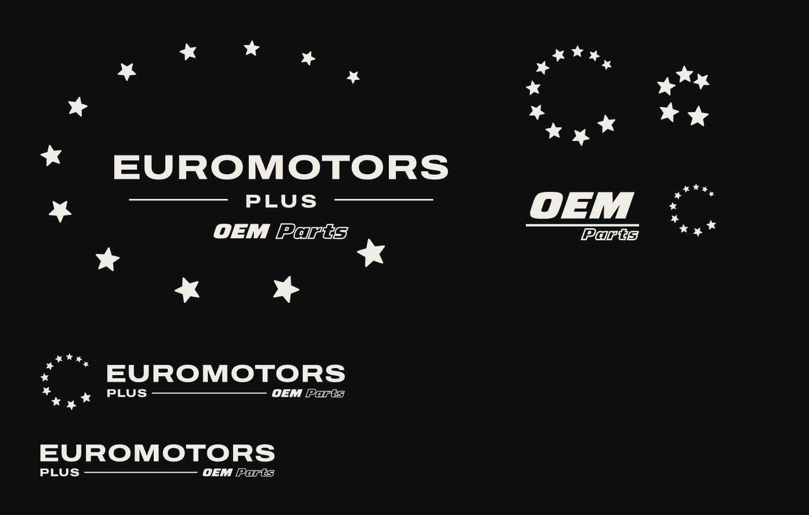
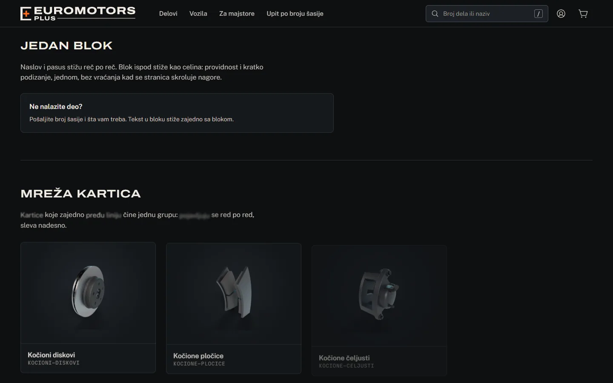
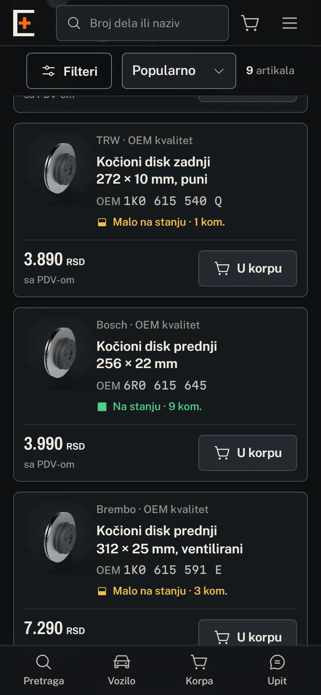
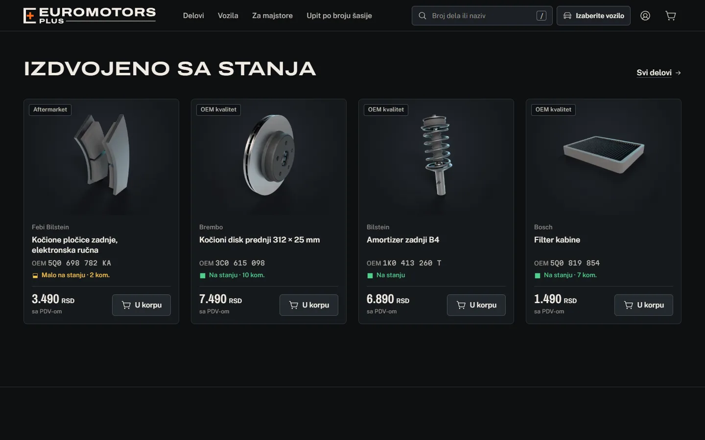

# Euromotors Plus · OEM Parts — Predaja projekta

> Za programera i za klijenta. Tehničko uputstvo za programere je u [`README.md`](../README.md), spisak za objavu u [`GO-LIVE.md`](GO-LIVE.md), a prikaz sa snimcima ekrana u [`showcase/index.html`](showcase/index.html) (otvara se dvoklikom, radi bez interneta).
>
> Stanje: 12.10.2026. Sajt radi na razvojnoj bazi sa demo podacima. Ništa još nije objavljeno.
>
> **Novo od prve predaje (01.10.2026.):** sajt se zove „Euromotors Plus“ i ima nov znak ([§11](#11-ime-i-znak)), ceo izgled je dorađen ([§12](#12-šta-je-novo)), a pojavljivanje sadržaja pri skrolovanju se podešava jednim brojem ([§13](#13-linija-pojavljivanja-sadržaja)).

## Sadržaj

1. [Šta je napravljeno](#1-šta-je-napravljeno)
2. [Kako se koristi admin, korak po korak](#2-kako-se-koristi-admin-korak-po-korak)
3. [Uvoz iz Excela](#3-uvoz-iz-excela)
4. [Tok porudžbine](#4-tok-porudžbine)
5. [Tok upita i ponude](#5-tok-upita-i-ponude)
6. [Obaveštenja](#6-obaveštenja)
7. [Majstori i rabat](#7-majstori-i-rabat)
8. [Šta je privremeno](#8-šta-je-privremeno)
9. [Brisanje demo podataka](#9-brisanje-demo-podataka)
10. [Demo za klijenta: redosled](#10-demo-za-klijenta-redosled)
11. [Ime i znak](#11-ime-i-znak)
12. [Šta je novo](#12-šta-je-novo)
13. [Linija pojavljivanja sadržaja](#13-linija-pojavljivanja-sadržaja)

---

## 1. Šta je napravljeno

### Prodavnica (javni deo)

| Deo | Šta radi |
|---|---|
| **Početna strana** | 3D auto u rendgen prikazu. Dok se stranica skroluje, auto se rasklapa u 7 faza; klik na neki od 91 dela otvara artikle te kategorije koji su na stanju, sa cenom i dugmetom za korpu. Ispod: pretraga po broju dela, izbor vozila, kako se poručuje, „Izdvojeno sa stanja“ (po jedan tražen deo na stanju iz četiri kategorije), devet sistema sa kategorijama, deo za majstore, marke, česta pitanja i kontakt. Za tastaturu i čitače ekrana postoji „Lista delova“. |
| **Zaglavlje i donja traka** | Zaglavlje sa znakom, pretragom kao glavnom radnjom i izborom vozila; pri skrolovanju se skuplja. Na telefonu je na dnu traka Pretraga · Vozilo · Korpa · Kontakt. Vidi [§12](#12-šta-je-novo). |
| **Katalog** | `/delovi` sa svim kategorijama, strana kategorije sa filterima (vozilo, proizvođač, kvalitet, stanje, cena), strane vozila (`/vozila/marka/model/generacija`) i strane „kategorija × vozilo“ koje Google indeksira tek kad imaju dovoljno artikala. |
| **Pretraga** | Prepoznaje kataloške (OEM) brojeve bez obzira na razmake, tačke, crtice i velika slova, pa zamenske brojeve, pa nazive. Pretraga bez rezultata nudi upit i beleži se u adminu („Traženo, a nemamo“). |
| **Artikal** | Kataloški i zamenski brojevi sa dugmetom za kopiranje, tabela vozila kojima odgovara, cena sa PDV-om (majstor vidi svoju), stanje i rok, korpa, upit, poziv, Viber i WhatsApp, „Javi mi kad stigne“. |
| **Korpa i porudžbina** | Bez plaćanja na sajtu. Četiri koraka: kontakt → dostava → plaćanje → pregled. Može bez naloga. Firma upisuje PIB (proverava se kontrolna cifra) i matični broj. Plaćanje: pouzećem, gotovinom ili karticom pri preuzimanju, virmanom po predračunu, odloženo (samo odobreni majstori). Posle slanja kupac dobija stranu sa statusom porudžbine i predračunom za štampu. |
| **Upit po broju šasije** | „Ne nalazite deo?“: broj šasije (iz njega se prepoznaju marka i godina), vozilo, šta treba, do 5 fotografija, kontakt. Kupac dobija link na kom vidi ponudu i prihvata je; prihvaćena ponuda postaje porudžbina. |
| **Nalog kupca** | Porudžbine sa „Poruči ponovo“, upiti, sačuvana vozila, profil. |
| **Pravne i statične strane** | O nama, kontakt, dostava i plaćanje, reklamacije i povrat, uslovi korišćenja, politika privatnosti, kolačići. Podaci firme se čitaju iz podešavanja. Tekstovi čekaju pravnika (vidi [GO-LIVE](GO-LIVE.md)). |
| **Kolačići i merenje** | Baner za kolačiće (Consent Mode v2). Ništa od Google-a i Mete se ne učitava pre pristanka. Posle pristanka: GA4, Google Ads konverzije i Meta Pixel, plus Meta Conversions API sa servera. Izvor posete (oglas, kampanja) se čuva uz svaku porudžbinu, upit i registraciju. |
| **SEO** | Naslovi i opisi za svaku stranu, strukturirani podaci (prodavnica, artikli, putanja, česta pitanja), sitemap, robots, slike za deljenje, feed za Google Merchant i Meta katalog. |

### Majstorski portal

Registracija servisa (`/za-majstore/registracija`), odobrenje u adminu, cena sa rabatom na svakom ekranu, brza porudžbina iz nalepljenog spiska brojeva, istorija i ponovno poručivanje, omiljeni artikli, vozila mušterija, cenovnik u Excelu i odloženo plaćanje. Detalji u [§7](#7-majstori-i-rabat).

### Admin (`/admin`)

| Ekran | Šta radi |
|---|---|
| Pregled | Porudžbine i promet danas i za 7 dana, upiti bez odgovora (vreme čekanja u radnom vremenu), majstori na odobrenju, artikli bez zaliha, red čekanja, aktivnost. |
| Porudžbine | Lista sa pretragom i filterima, detalj, promena statusa (i iz reda u listi: klik na oznaku statusa nudi dozvoljene sledeće korake), vreme čekanja u četiri stepena, izmena stavki pre potvrde, broj pošiljke, napomene, predračun i otpremnica za štampu, izvoz. |
| Upiti | Lista i detalj sa fotografijama, ponuda, pretvaranje u porudžbinu. Upiti majstora su označeni. |
| Kupci, Majstori | Kupci sa porudžbinama i beleškama, blokiranje; majstori sa odobrenjem, nivoom rabata, izuzecima i odloženim plaćanjem. |
| Proizvodi | Tabela sa pretragom i grupnim izmenama (sa poništavanjem), uređivač artikla: slike, brojevi, vozila, stanje, cene, nabavna cena, SEO, istorija izmena. |
| Uvoz iz Excela, Izvoz | Vidi [§3](#3-uvoz-iz-excela). |
| Kategorije, Vozila, Proizvođači | Stablo kategorija sa SEO tekstom, slikom i vezom ka delu 3D auta; marke, modeli, generacije, motori; proizvođači i nivo kvaliteta. |
| Lager | Artikli bez zaliha i sa malo zaliha, svako kretanje zaliha sa razlogom i ko ga je napravio. |
| Pretrage, Izvori | Šta su ljudi tražili (i šta nismo imali); odakle dolaze porudžbine i upiti (Google Ads, Meta, organski), CSV za Google Ads offline konverzije. |
| E-pošta | Svaka poslata (ili zapisana) poruka, šabloni sa pregledom i „Pošalji probnu poruku“. |
| Revizija | Svaka izmena koju je napravilo osoblje: ko, kada, šta. |
| Privatnost | Samo vlasnik: izvoz svih podataka o jednoj osobi i anonimizacija na zahtev kupca. |
| Podešavanja | Firma, radno vreme, dostava i plaćanje, prodaja, obaveštenja, SEO, praćenje (GA4, Google Ads, Meta), oglasne strane, pravni tekstovi, funkcije, opasna zona. |
| Korisnici | Zaposleni, pozivnice, uloge, lična obaveštenja. |

Gornja traka ima pretragu i komande (`Ctrl K`: broj porudžbine, OEM broj, telefon…) i zvonce sa obaveštenjima u realnom vremenu.

---

## 2. Kako se koristi admin, korak po korak

### 2.1 Prijava

1. Otvorite `/prijava` i prijavite se nalogom vlasnika.
2. Posle prijave idite na `/admin`. Kupci i majstori nemaju pristup adminu.
3. Lozinku promenite na `/zaboravljena-lozinka`. Dok mejlovi nisu povezani, kod za novu lozinku se vidi u Admin → E-pošta.

### 2.2 Pregled


Žuta traka na vrhu znači da podaci o firmi nisu uneti; ista traka se vidi na predračunu i otpremnici (ne štampa se). Kartica „Upiti bez odgovora“ pokazuje koliko upita čeka i koliko dugo, računajući samo radno vreme. „Red čekanja“ je spisak onoga što treba uraditi sada, najstarije prvo.

### 2.3 Prvo podešavanje (jednom)


1. **Podešavanja → Firma:** pun naziv, PIB, matični broj, adresa sedišta i radnje, telefon, Viber, WhatsApp, e-pošta, tekući račun. PIB, matični broj i račun se proveravaju kontrolnom cifrom. Ovi podaci idu u podnožje sajta, u mejlove, na predračun i otpremnicu.
2. **Radno vreme:** dani, sati i neradni dani. Podsetnici za neodgovorene porudžbine i upite računaju samo radno vreme.
3. **Dostava i plaćanje:** cene dostave i prag za besplatnu dostavu, koji načini plaćanja su uključeni, linkovi za praćenje pošiljke po kurirskoj službi.
4. **Prodaja:** prag „malo na stanju“, rok „po porudžbini“, rok za slanje istog dana (prazno = rečenica se ne prikazuje).
5. **Obaveštenja:** adrese osoblja, sat dnevnog pregleda, režim slanja e-pošte ([§6](#6-obaveštenja)).
6. **Korisnici → Pozovi zaposlenog:** upišite e-poštu zaposlenog, kopirajte link i pošaljite mu ga (Viber, SMS). Link važi 7 dana i samo za tu adresu.


### 2.4 Svakodnevni rad

- **Nova porudžbina:** zvonce + mejl (kad je povezan Resend). Otvorite je iz zvonceta ili iz Porudžbine → kartica „Nove“. Tok je u [§4](#4-tok-porudžbine).
- **Novi upit:** isto, u Upiti. Tok je u [§5](#5-tok-upita-i-ponude).
- **Novi majstor:** Majstori → „Na čekanju“. Tok je u [§7](#7-majstori-i-rabat).
- **Artikal:** Proizvodi → „Novi artikal“ ili klik na red. Obavezni su naziv, kategorija, cena i stanje; kataloški brojevi se upisuju kako god stoje na kutiji, sistem ih sam normalizuje i pokaže kako će ih čitati. Slike se prevlače mišem i redosled se menja prevlačenjem.
- **Grupna izmena:** u Proizvodi označite redove → „Grupne radnje“ (cena u procentima, aktivno/neaktivno, kategorija). Posle izmene je dostupno „Poništi“.
- **Lager:** Lager → „Bez zaliha“ i „Malo na stanju“. Svaka promena stanja (porudžbina, otkazivanje, uvoz, ručna izmena) ostaje zapisana sa razlogom.


- **Traženo, a nemamo:** Pretrage → tabela „Traženo, a nemamo“. To je spisak delova koje kupci traže, a vi ih nemate u katalogu.


- **Kategorije:** stablo levo, desno SEO tekst za stranu kategorije, slika i deo 3D auta na koji kategorija reaguje.


### 2.5 Prečice

`Ctrl K` pretraga i komande · `/` pretraga na stranici · `g` pa slovo stavke menija (npr. idi na porudžbine) · `n` pa `a` novi artikal · strelice gore/dole po redovima tabele, `Enter` otvara red, razmak označava red za grupne radnje. Ceo spisak otvara `?`.

---

## 3. Uvoz iz Excela

Uvoz čita ono što vaš knjigovodstveni program izveze: `.xlsx`, `.xls` ili `.csv` (i stari Windows-1250 CSV sa č, ć, ž, š, đ), do 25 MB i 50.000 redova.

1. **Admin → Uvoz iz Excela → „Šablon (.xlsx)“** ako hoćete prazan šablon sa uputstvom, spiskom kategorija, proizvođača i vozila. Ako koristite izvoz iz programa, šablon nije potreban.
2. **Datoteka:** prevucite fajl. Sistem nađe list i red sa zaglavljem (može i ispod naslova) i pokaže prvih nekoliko redova.

   

3. **Kolone:** kolone se same povezuju po nazivu („Šifra artikla“, „Kat. br.“, „MPC“, „Lager“…, i na engleskom). Proverite i po potrebi promenite. Izaberite režim:
   - **Pun uvoz:** pravi nove artikle i menja postojeće (po šifri).
   - **Samo stanje i cene:** menja samo količinu i cenu postojećih artikala; ništa novo ne pravi.

   Kliknite „Sačuvaj mapiranje“ i sledeći put se kolone povežu same.

   

4. **Provera:** greške i upozorenja po redu (nema cene, nepoznata kategorija, negativno stanje…). Nepoznate kategorije iz programa povežete jednom za ceo fajl; nepoznate proizvođače napravite ili povežete. Spisak problema se preuzima kao `.xlsx`.

   

5. **Probni uvoz:** server pokaže tačno šta će se desiti: koliko novih, izmenjenih, nepromenjenih, preskočenih i grešaka, sa primerima „pre → posle“. Ništa još nije upisano.
6. **Upis:** upis ide u delovima, sa trakom napretka. Može da se zatvori stranica i vrati kasnije.
7. **Poništavanje:** Uvoz → Istorija → uvoz → „Poništi uvoz“ vraća stare vrednosti, briše artikle koje je uvoz napravio (ako ih niko nije menjao ili poručio) i preskače artikle koje je neko menjao posle uvoza.

Dodatno:

- **Deaktiviranje artikala kojih nema u fajlu** koristite samo sa punim cenovnikom. Traži da upišete reč `DEAKTIVIRAJ` i može da se poništi.
- **Cena u fajlu:** ako program izvozi samo veleprodajnu cenu bez PDV-a, uvoz računa maloprodajnu kao VP × 1,2 i to prikazuje kao upozorenje.
- **Slike sa adresa** (kolona sa URL-om slike) se preuzimaju posle upisa, samo za artikle koji još nemaju slike.
- **Ručni unos** jedan po jedan: Proizvodi → „Novi artikal“. Provere su iste kao kod uvoza.
- **Izvoz:** Admin → Izvoz: artikli u `.xlsx` (isti format kao šablon, može da se izmeni i vrati uvozom), porudžbine, kupci i majstori u `.csv`.


---

## 4. Tok porudžbine

```
nova → potvrđena → spremna za preuzimanje → preuzeta  → završena
                 ↘ poslata                → isporučena ↗
otkazana (iz svakog otvorenog stanja) · čeka deo (deo se naručuje)
```


1. **Kupac poruči.** Porudžbina dobija broj `SK-2026-000123` i status „nova“. Kupac dobija mejl „Porudžbina je primljena“, osoblje zvonce i mejl.
2. **Proverite i potvrdite.** Otvorite porudžbinu. Pre potvrde možete da izmenite stavke („Izmeni stavke“), npr. kad je kupac tražio pogrešan deo. Kliknite **Potvrdi**. Tada se stanje umanjuje, a kupac dobija mejl „Porudžbina je potvrđena“ (sa podacima za uplatu kad plaća po predračunu).

   

3. **Pripremite.**
   - Lično preuzimanje: **Promeni status → Spremna za preuzimanje**, kupac dobija mejl da može da dođe.
   - Kurir: **Upiši broj pošiljke**, izaberite kurirsku službu, pa **Označi kao poslato**. Kupac dobija mejl sa brojem pošiljke (i linkom za praćenje kad unesete linkove kurira u podešavanjima).
4. **Završetak.** **Označi kao preuzeto** ili **Označi kao isporučeno**. Kada novac stigne, **Označi kao plaćeno**. Porudžbina se sama zatvara 15 dana posle isporuke (podesivo).
5. **Otkazivanje.** Promeni status → Otkaži, sa razlogom. Stanje se vraća tačno onoliko koliko je uzeto, kupac dobija mejl.
6. **Štampa.** Dugmad **Predračun** i **Otpremnica** otvaraju verziju za štampu (A4). Više otpremnica odjednom: označite porudžbine u listi.

Uz svaku porudžbinu se vidi i odakle je kupac došao (oglas, kampanja, ključna reč), interne napomene (kupac vidi samo one označene „Vidljivo kupcu“) i cela istorija promena.

---

## 5. Tok upita i ponude

```
nov → u obradi → ponuda poslata → prihvaćena (→ porudžbina) | odbijena | istekla
```


1. **Kupac pošalje upit** sa `/upit`, iz pretrage bez rezultata ili sa strane artikla. Upit dobija broj `UP-2026-000045`. Kupac dobija mejl, osoblje zvonce i mejl. Upiti majstora su označeni i idu prvi.
2. **Preuzmite upit** (status „u obradi“) da kolege vide da radite na njemu.
3. **Napravite ponudu:** stavke iz kataloga (pretraga po broju ili nazivu) ili slobodne stavke, sa cenom, rokom isporuke i napomenom; važenje ponude (podrazumevano 7 dana). „Sačuvaj nacrt“ ako niste gotovi, **Pošalji ponudu** kad jeste.

   

4. **Kupac dobija mejl „Ponuda je spremna“** sa linkom. Na toj strani prihvata ponudu (postaje porudžbina sa tim cenama), odbija je ili traži novu. Dan pre isteka dobija podsetnik.

   

5. **Kupac bez e-pošte** (pitao telefonom ili Viberom): posle slanja ponude pojavi se „Link za kupca“ sa dugmićima za Viber, WhatsApp i SMS; link mu pošaljete vi. Kad kupac prihvati telefonom, kliknite **Pretvori u porudžbinu**.

---

## 6. Obaveštenja

Svaki događaj (nova porudžbina, promena statusa, upit, ponuda, registracija majstora, malo zaliha) ide kroz isti red: u zvonce u adminu odmah, i kao mejl ako je primalac tako izabrao.

**Kupci dobijaju mejl** za: porudžbinu primljenu, potvrđenu, spremnu, poslatu, isporučenu i otkazanu; upit primljen; ponudu spremnu (i podsetnik pred istek); „deo je stigao“; registraciju majstora primljenu, odobrenu i odbijenu; novu lozinku. Ukupno 25 šablona na srpskom, svaki i kao običan tekst, sa podacima firme iz podešavanja.


**Osoblje dobija:** mejl i zvonce za novu porudžbinu, upit, registraciju majstora i malo zaliha; dnevni pregled u 08:00; podsetnik za porudžbine i upite bez odgovora (prvi posle 120 minuta radnog vremena, drugi 2 sata kasnije). Svaki zaposleni bira šta dobija u Podešavanja → Obaveštenja.

**Režimi slanja** (Podešavanja → Obaveštenja → Slanje e-pošte):

| Režim | Šta radi |
|---|---|
| **Samo zapis** (sada) | Poruke se prave i vide u Admin → E-pošta, ništa ne odlazi. |
| **Test** | Sve ide na probnu adresu Resend-a, ne pravim ljudima. Za proveru izgleda. |
| **Uživo** | Pravi mejlovi kupcima i osoblju. |

Ako nedostaje Resend ključ ili adresa pošiljaoca, sajt sam ostaje na „Samo zapis“ i to piše u podešavanjima. Demo porudžbine i upiti se nikad ne šalju. Neisporučeni mejlovi se ponavljaju 5 puta (1 min, 5 min, 30 min, 2 h, 12 h); odbijene adrese se vide u zvoncu i u istoriji porudžbine. U **E-pošta** svaka poruka ima „Pošalji ponovo“; u **E-pošta → Šabloni** svaki šablon može da se pogleda kao na računaru, telefonu ili kao tekst, i pošalje kao probna poruka.


Viber i WhatsApp su linkovi „klikni i piši“ (sa brojem porudžbine u poruci), bez plaćenih servisa. SMS i Telegram nisu deo prve verzije.

---

## 7. Majstori i rabat


**Registracija.** Servis popuni `/za-majstore/registracija`: firma, PIB, matični broj, kontakt osoba, telefon, e-pošta, grad, adresa, vrsta servisa, marke. Nalog je „na čekanju“, osoblje dobija zvonce i mejl, servis vidi stranu „čeka odobrenje“.

**Odobrenje** (Majstori → servis):

1. Proverite firmu (PIB i matični broj su već provereni kontrolnom cifrom).
2. Izaberite **nivo rabata**: Majstor 10 %, Majstor Plus 15 %, Partner 20 % (procenti se menjaju u Cenovni razredi).
3. Po potrebi: lični rabat, izuzeci po kategoriji ili proizvođaču (npr. 25 % na diskove), **odloženo plaćanje** sa limitom i rokom (prazan limit = bez limita).
4. **Odobri nalog.** Servis dobija mejl i od tada vidi svoje cene. Odbijanje traži razlog; nalog može i da se suspenduje i ponovo aktivira.

**Kako se računa cena.** Na serveru, za svaki artikal: osnovni rabat nivoa → izuzetak po kategoriji ili proizvođaču → lični rabat. Cena nikad ne ide ispod nabavne cene uvećane za minimalnu maržu (podrazumevano 8 %), kad je nabavna cena poznata. Majstor vidi maloprodajnu cenu precrtanu i „Vaša cena“ ispod. Njegova cena se ne vidi drugim kupcima, ne ulazi u keš stranica ni u izvorni kod strane.


**Šta majstor ima u portalu** (`/majstor`):

- **Brza porudžbina:** nalepi redove kao `1K0615301AA 2` ili učita CSV. Svaki red dobija „tačno“, „više opcija“ (bira proizvođača) ili „nije pronađeno“. Jedno dugme dodaje sve u korpu, drugo šalje nepronađene brojeve kao upit.

  

- Istorija porudžbina sa „Poruči ponovo“, omiljeni artikli, vozila mušterija (VIN, tablice, napomena), cenovnik po izabranim kategorijama u Excelu, profil i upiti.
- **Odloženo plaćanje** se nudi na porudžbini samo ako ste ga uključili, sa preostalim limitom. Porudžbina preko limita se odbija.

Zaposleni koji je i majstor ne može sam sebi da odobri profil niti da menja svoj rabat; to radi vlasnik.

---

## 8. Šta je privremeno

| Šta | Gde se menja |
|---|---|
| **Naziv i znak** | Sajt nosi naziv „Euromotors Plus“ i znak sa lukom od zvezda „Euromotors Plus · OEM Parts“ (korak 33, pravac koji je vlasnik izabrao). Naziv nije privremen; znak čeka potvrdu klijenta i proveru žiga (GO-LIVE §A). Gde se šta menja i gde je komplet znaka: [§11](#11-ime-i-znak). |
| **Početak broja porudžbine „SK“** | Ostatak radnog naziva. Podešavanja → Firma → „Prefiks porudžbine“, pre prve prave porudžbine. |
| **Demo artikli** `DEMO-0001`…`DEMO-0150` i zamene `DEMO-E001`…`DEMO-E007` (izmišljeni kataloški brojevi, označeni „VAG (demo)“), demo majstor, 8 demo porudžbina, 4 demo upita | [§9](#9-brisanje-demo-podataka) |
| **Probni zapisi iz automatskih testova** na razvojnoj bazi (porudžbine i upiti od „Admin Test…“, „Auto servis E2E“, adrese `@primer.rs`) | Ostaju na razvojnoj bazi. Produkciona baza počinje prazna, pa ih tamo nema. |
| **Demo oglasna strana** `/ponuda/kocione-plocice-golf` | Podešavanja → Oglasne strane |
| **Podaci firme, kontakt, radno vreme, tekući račun** | Prazni; sajt ih ne prikazuje dok se ne unesu (Podešavanja → Firma). |
| **Pravni tekstovi** | Šabloni po srpskim zakonima, označeni „potreban pravni pregled“ (Podešavanja → Pravni tekstovi). |
| **O nama, Kontakt i pravne strane** | Opšti tekstovi bez izmišljenih podataka; menjaju se u Podešavanja → Pravni tekstovi (Markdown sa pregledom). |
| **Česta pitanja** (početna, dostava, za majstore) | Admin još nema ekran za njih: izmenu radi programer u `convex/seedData/content.ts` i pušta je skriptom. Dodavanje tog ekrana je mala dorada (vidi GO-LIVE §D). |
| **Pravila prodaje** (dostava 450 RSD, besplatno preko 10.000 RSD; rabat 10/15/20 %; marža 8 %; važenje ponude 7 dana; prag zaliha 3 kom.) | Podešavanja i Cenovni razredi. Potvrditi sa klijentom (GO-LIVE §B). |
| **Mejlovi** u režimu „Samo zapis“ | Posle povezivanja Resend-a (GO-LIVE §5). |
| **GA4, Google Ads, Meta** | Polja prazna, nijedan kod se ne učitava (Podešavanja → Praćenje). |
| **Slike artikala** | Do pravih fotografija koriste se renderi kategorija iz 3D modela. |
| **Podaci o vozilima** (godine, VIN kodovi, kodovi motora) | Uneti po opšte poznatim podacima, označeni „seed – proveriti“ (Admin → Vozila). |
| **Linkovi za praćenje pošiljke** | Prazni dok se ne potvrde (Podešavanja → Dostava i plaćanje). |

---

## 9. Brisanje demo podataka

Pre objave, i najkasnije pre prebacivanja mejlova na „Uživo“:

1. Napravite rezervnu kopiju baze ([`BACKUPS.md`](BACKUPS.md) §1).
2. Prijavite se kao **vlasnik** (zaposleni ne vide ovu opciju).
3. **Admin → Podešavanja → Opasna zona → „Obriši demo podatke“.** Pokazuje koliko artikala, porudžbina, upita i naloga je označeno kao demo.
4. Upišite potvrdu `OBRIŠI DEMO` i potvrdite. Brisanje ide u delovima i ne dira ništa što nije označeno kao demo (pravi artikli, porudžbine, podešavanja, kategorije i vozila ostaju).
5. Posebno obrišite ili izmenite demo oglasnu stranu u Podešavanja → Oglasne strane.

Na produkciji je jednostavnije: nova baza se napuni referentnim podacima i demo artiklima (`seed:run`), proveri se da sve radi, pa se demo podaci obrišu ovim dugmetom. Postupak je u GO-LIVE §3.

---

## 10. Demo za klijenta: redosled

Otvorite [`showcase/index.html`](showcase/index.html) za pregled sa snimcima, ili pokrenite sajt lokalno (README → Setup) i idite ovim redom (oko 15 minuta):

0. **Znak:** otvorite [`brand/BRAND-BOARD.html`](brand/BRAND-BOARD.html) i pokažite znak, njegove oblike i primenu. Ovo je prva stvar koju klijent treba da odobri.
1. **Početna:** skrolujte da se auto rasklopi, kliknite na turbinu, pokažite panel sa cenom i stanjem. Dugme „Lista delova“ za istu stvar bez 3D-a. Skrolujte dalje polako, da se vidi kako sadržaj stiže; isto pokažite na telefonu, sa donjom trakom.
2. **Pretraga:** u polje upišite `5q0-615-666-a` (namerno sa crticama i malim slovima), pokažite da nađe disk.
3. **Kategorija** `/delovi/kocioni-diskovi`: izaberite vozilo (Volkswagen → Golf → Golf VII), filteri se suze.
4. **Artikal → Dodaj u korpu → Porudžbina:** prođite korake do pregleda (bez plaćanja na sajtu).
5. **Upit** `/upit`: upišite broj šasije `WVWZZZ1KZ8W123456`, sistem prepozna marku i godinu.
6. **Majstor:** odjavite se, prijavite kao demo majstor, pokažite „Vaša cena“ na istom artiklu i brzu porudžbinu sa spiskom brojeva.
7. **Admin:** pregled, jedna porudžbina (Potvrdi → mejl u E-pošta), jedan upit sa ponudom, uvoz iz Excela do koraka „Provera“ (fajl `tests/fixtures/import/proizvodi-500.xlsx`), E-pošta → Šabloni.
8. **Pre objave:** šta treba od klijenta (GO-LIVE §A).

Pristupni podaci za razvojnu bazu nisu u ovom dokumentu: vlasnik je u `pipeline/env/ADMIN-CREDENTIALS.txt` (nije u gitu), demo majstor i kupac iz testova u `.playwright/audit-accounts.json`.

---

## 11. Ime i znak

### 11.1 Ime

| Šta | Kako se piše | Gde se vidi |
|---|---|---|
| Ime firme i sajta | **Euromotors Plus** (ne „Euromotors+“) | Zaglavlje, podnožje, naslovi strana, mejlovi (ime pošiljaoca), predračun, otpremnica, ikonica. |
| Poznati naziv radnje | **OEM Parts** | Kraj naslova strana („ \| Euromotors Plus · OEM Parts“), podaci za Google, ispod imena u znaku. |
| Naziv crteža znaka | „Euromotors Plus · OEM Parts“ | Ime znaka (opis slike za čitače ekrana, naziv aplikacije na telefonu). Reč „by“ se više ne koristi. |

Gde se menja, bez programera:

- **Podešavanja → Firma → „Brend i brojevi dokumenata“:** naziv, „Poznati naziv radnje“, slogan, „Prefiks porudžbine“.
- **Podešavanja → SEO → „Dodatak naslovu“:** šta stoji na kraju naslova strana. Kad je naslov dugačak, sajt sam ostavlja samo „ | Euromotors Plus“, a kod najdužih naziva artikala ništa.
- **Podešavanja → Obaveštenja → Slanje e-pošte → „Ime pošiljaoca“:** prazno polje znači „Euromotors Plus“.

Od radnog naziva „SKLOP“ ostalo je samo ovo, namerno: brojevi porudžbina počinju sa „SK“ (menja se prefiksom iznad, pre prve prave porudžbine), slogan „Rasklopi auto. Nađi deo.“ (menja se u istom odeljku) i ime „Euromotors“ ispod ikonice kad kupac doda sajt na početni ekran telefona (telefoni prikazuju najviše 12 znakova). Pravila pisanja za programera su u `lib/domain/brand.ts`.

### 11.2 Gde je komplet znaka

Znak je luk od dvanaest zvezda sa prvog loga firme, nacrtan iznova (korak 33, pravac koji je vlasnik izabrao). Zamenio je znak sa slovom E i narandžastim plusom iz koraka 24.



| Šta | Gde | Za koga |
|---|---|---|
| **Tabla za klijenta** | [`brand/BRAND-BOARD.html`](brand/BRAND-BOARD.html) (dvoklik, radi bez interneta) i slika [`brand/BRAND-BOARD.png`](brand/BRAND-BOARD.png) | Prikazivanje i odobrenje znaka. |
| **Uputstvo za znak** | [`brand/LOGO.md`](brand/LOGO.md) | Svi oblici, boje, pravila, pisma i licence. |
| **Vektori (SVG)** | `docs/brand/export/svg/`, 30 datoteka | Dizajner, štampar, firma koja pravi tablu. |
| **Vektori (PDF)** | `docs/brand/export/pdf/`, 30 datoteka | Štampa. Svetle varijante su na tamnoj podlozi da se vide kad se otvore. |
| **Slike (PNG)** | `docs/brand/export/png/`, 90 datoteka: svaka u tri veličine (osnovna, `@2x`, `@4x`), providna podloga | Word, Excel, Viber, društvene mreže. |
| **Ikonice i gotovi formati** | `docs/brand/export/icons/`: `favicon.ico`, ikonice aplikacije, `email-header@2x.png` i `email-header-dark@2x.png`, `social-avatar.png` | Profilna slika, potpis u e-pošti. |
| **Spisak svih datoteka** | `docs/brand/export/manifest.json` | Dimenzije svake datoteke. |
| **Znak na sajtu, slike** | [`brand/site/`](brand/site/) | Kako znak stoji u zaglavlju, podnožju, adminu, mejlu, na predračunu, na slici za deljenje i u kartici pregledača. |
| **Datoteke koje koristi sajt** | `public/brand/` | Programer. Ne menjaju se ručno. |

Datoteke se zovu `oblik-boja`, na primer `logo-stacked-navy.svg` ili `mark-black@2x.png`.

### 11.3 Kako se koristi

**Koji oblik:**

| Oblik | Datoteka | Kada | Najmanja visina |
|---|---|---|---|
| Uspravni (osnovni: luk od 12 zvezda oko imena) | `logo-stacked-*` | Tabla iznad radnje, vozilo, nalepnica, naslovna strana ponude, podnožje sajta. | 128 px · 32 mm |
| Vodoravni (prsten od 10 zvezda, ime desno) | `logo-horizontal-*` | Zaglavlje sajta, admin, e-pošta, predračun, otpremnica, slika za deljenje. | 44 px · 12 mm |
| Znak (10 zvezda) | `mark-*` | Ikonica aplikacije, profilna slika, pečat. | 48 px · 12 mm |
| Mali znak (5 zvezda) | `mark-small-*` | 32 px i manje: kartica pregledača, zaglavlje na telefonu. | 16 px · 4 mm |
| Samo ime | `logo-wordmark-*` | Kad znak već stoji pored. | 28 px · 8 mm |
| OEM Parts | `oem-parts-*` | Mesta gde stoji samo „OEM Parts“. | 40 px · 12 mm |

Ako oblik ne staje u visinu iz tabele, uzima se sledeći manji. Znak se ne sužava da bi stao.

**Koja boja:** znak je uvek u jednoj boji. `-night` (topla bela) za tamne podloge · `-navy` (tamnoplava prvog znaka firme) za štampu, dokumenta i e-poštu na beloj · `-paper` (grafit) za belu podlogu na ekranu · `-black` i `-white` za jednobojnu štampu, pečat, graviranje. Narandžasta nije u znaku.

**Kome šta poslati:**

- **Štamparu i firmi koja pravi tablu ili oslikava vozilo:** PDF ili SVG, nikad PNG. Boje za štampu (Pantone, CMYK) nisu u kompletu; biraju se sa štamparom, sa probnog otiska, prema `#1B2A6B` (tamnoplava) i `#0D0F11` (tamna podloga).
- **Za Word, Excel, ponudu, Viber:** PNG `@2x` u varijanti `-navy` (bela podloga) ili `-night` (tamna).
- **Profilna slika na mrežama i Viberu:** `icons/social-avatar.png` (1000 × 1000; mreže je same seku u krug).
- **Potpis u e-pošti:** `icons/email-header@2x.png`, prikazan u veličini 336 × 88.

**Pravila ukratko:**

- Oko znaka ostaje prazan prostor visine najveće zvezde.
- Luk se ne zatvara, zvezde se ne izjednačavaju i ne ispravljaju (dvanaest jednakih zvezda u krugu je amblem Evropske unije), luk se ne okreće: otvor je uvek desno.
- Ne razvlači se, ne naginje, ne boji narandžasto ni u više boja, bez senke, sjaja i okvira.
- Ne stavlja se na šarenu ili fotografsku podlogu bez dovoljnog kontrasta.
- Ne stoji uz znakove proizvođača vozila tako da izgleda kao da je radnja njihov ovlašćeni partner.

Ceo spisak pravila je u [`brand/LOGO.md`](brand/LOGO.md) §4.

### 11.4 Ako znak treba izmeniti (programer)

Znak se ne crta ručno. Geometrija i sve mere su u `scripts/brand/logo/logo.mjs`; posle izmene:

```bash
node scripts/brand/logo/build.mjs     # public/brand i docs/brand/export
node scripts/brand/logo/site.mjs      # ono što sajt koristi: components/brand/logoPaths.ts, ikonice
node scripts/brand/logo/verify.mjs    # 12 provera
node scripts/brand/logo/renders.mjs   # pregledi u docs/brand/renders
node scripts/brand/logo/board.mjs     # tabla za klijenta
```

Na sajtu se znak koristi samo preko komponenti u `components/brand/` i gotovih datoteka iz `public/brand/`. Koji oblik stoji gde: `docs/design/DESIGN-SYSTEM.md` §2.4.

### 11.5 Šta čeka klijenta

Potvrda znaka, provera žiga (posebno zbog zvezda, videti [`brand/LOGO.md`](brand/LOGO.md) §8) i boje za štampu. Stavke su u [GO-LIVE §A](GO-LIVE.md#znak-i-ime-koraci-24-25-i-33).

---

## 12. Šta je novo

Posle prve predaje sajt je dobio novo ime i znak (koraci 24 i 25) i dorađen izgled svake strane (koraci 26 do 28). Poslovna logika, tokovi porudžbine i upita, cene i admin funkcije su isti; promenjeno je kako sajt izgleda i kako se ponaša pod rukom. Svi snimci su u [`showcase/index.html`](showcase/index.html), odeljak „Šta je novo“.

### 12.1 Meki uglovi

Nijedna kutija na sajtu više nema oštre uglove. Zaobljenje zavisi od uloge elementa:

| Element | Zaobljenje |
|---|---|
| Oznake, čipovi, polja za potvrdu | 4 px |
| Dugmad, polja za unos, padajuće liste | 6 px |
| Kartice, paneli, tabele, obaveštenja, meniji | 8 px |
| Slike i okviri crteža | 10 px |
| Dijalozi, veliki paneli | 12 px |
| Paneli koji izlaze odozdo (gornji uglovi) | 14 px |

Ravni ostaju samo elementi koji idu od ivice do ivice ekrana: zaglavlje, podnožje, donja traka na telefonu, bočna traka admina. Isto važi u adminu i u mejlovima.

Ako želite mekše ili oštrije: šest brojeva na jednom mestu, `--radius-xs` do `--radius-2xl` u `app/globals.css`. Automatski test (`tests/e2e/corners.spec.ts`) pada ako se na sajtu pojavi kutija sa oštrim uglom.

### 12.2 Pojavljivanje sadržaja



Sve na strani stiže jednom, dok se skroluje:

- **Tekst** (naslovi, pasusi, stavke liste) stiže reč po reč.
- **Blokovi** (kartice, slike, paneli, redovi, tabele) stižu kao celina: iz providnog u vidljivo, uz podizanje od 16 px (12 px na telefonu), za oko pola sekunde.
- **Mreža kartica** stiže red po red, kartica za karticom, sa razmakom od 60 ms.
- Svaki element se pojavi jednom i ne nestaje kad se skroluje nazad.
- **Prvi ekran** je vidljiv odmah, pa strana ne čeka na animaciju.
- **U adminu** se ništa ne pomera: paneli i tabele samo postanu vidljivi, da dugme ostane tamo gde se pojavilo.
- Posetiocu koji je u sistemu uključio „smanji pokrete“ sve je odmah vidljivo. Bez JavaScript-a takođe.

Probna strana na kojoj se sve ovo vidi: `/styleguide/otkrivanje`. Kada sadržaj kreće, podešava se jednim brojem: [§13](#13-linija-pojavljivanja-sadržaja).

### 12.3 Novo zaglavlje i donja traka na telefonu



**Zaglavlje.** Na vrhu strane je više i providno, sa nešto većim znakom. U prvih 96 px skrolovanja skupi se na 64 px (56 px na telefonu) i dobije poluprovidnu podlogu. Pretraga je glavna radnja: najšire polje, na svakoj širini ekrana (ranije je na telefonu bila samo ikonica). Dugme za vozilo postaje narandžasto kad je vozilo izabrano. Na stranama koje počinju sopstvenim poljem za pretragu (početna, pretraga) polje u zaglavlju se pojavi tek kad se strana skroluje.

**Donja traka na telefonu:** Pretraga · Vozilo · Korpa · Kontakt, uvek pod palcem. Izabrano vozilo i puna korpa su narandžasti. „Kontakt“ otvara spisak kanala iz Podešavanja → Firma (telefon, Viber, WhatsApp, e-pošta), pa upit. **Dok ti podaci nisu upisani, na tom mestu stoji „Upit“**, kao na snimku. Strana artikla, korpa, porudžbina i portal za majstore imaju svoju donju traku (cena i dugme), pa se ova tamo ne prikazuje.

**Prelaz između strana.** Pri kliku na link nova strana se pojavi uz kratak prelaz (280 ms). Zaglavlje i donja traka se pri tome ne pomeraju.

U Firefoxu se strana menja bez prelaza, a zaglavlje je odmah u skupljenom obliku. To je predviđeno ponašanje, a ne greška: Chrome, Edge i Safari imaju oba.

### 12.4 Glavna poboljšanja po stranama



| Strana | Šta je novo |
|---|---|
| **Početna** | Na telefonu se auto vidi na prvom ekranu, a polje za pretragu i dugme su u jednom redu. Nova sekcija „Izdvojeno sa stanja“ prikazuje po jedan tražen deo na stanju iz kategorija kočione pločice, kočioni diskovi, amortizeri i filteri. Spisak od 44 linka zamenjen je sa devet panela po sistemima. |
| **Kartica artikla** | Slika popunjava okvir. Na telefonu je kartica niža (oko 190 px umesto 250), sa cenom i dugmetom u jednom redu, pa na ekran staje više artikala. Dugme za korpu je uvek vidljivo. |
| **Kategorija i pretraga** | Na telefonu jedna traka sa filterima, sortiranjem i brojem artikala koja ostaje na vrhu; prvi artikal je bliže vrhu ekrana. Filteri sa strane su u jednom panelu. Pretraga bez rezultata vodi na upit po broju šasije i nudi još dva puta dalje. |
| **Artikal** | Cena, stanje i „Dodaj u korpu“ su u jednoj izdignutoj kutiji koja na računaru prati skrolovanje. Na telefonu su naziv, kataloški broj, vozilo, cena i stanje na prvom ekranu, a traka sa cenom i dugmetom stoji na dnu dok se glavno dugme ne vidi. |
| **Korpa i porudžbina** | Stavke u jednom panelu, zbir u izdignutoj kutiji koja prati skrolovanje, bez dvostrukog međuzbira na telefonu. Svaki korak porudžbine je jedan panel. |
| **Upit po broju šasije** | Tri panela; pomoć za broj šasije stoji pored polja; ono što je iz broja prepoznato vidi se odmah. |
| **Portal za majstore, nalog, prijava** | U portalu četiri kartice (Pregled, Brza porudžbina, Porudžbine, Cenovnik), ostalo pod „Još“. Nalog u dve kolone. Prijava i registracija sa objašnjenjem pored obrasca. |
| **Tekstualne strane, 404** | Uža kolona za čitanje sa sadržajem sa strane. Kontakt u dve kolone, bez praznih blokova. Jedan izgled za sve strane grešaka. |
| **Admin** | Status porudžbine se menja iz reda u listi (svaki korak se potvrđuje). Vreme čekanja ima četiri stepena: u roku, rok ističe, kasni, dugo kasni. Redovi su visoki 48 px, a na dnu liste piše „50 od N“. Kartice na pregledu su šest zasebnih pločica. |
| **E-poruke** | Nov izgled sva 25 šablona: obaveštenje, dugme, stavke u dva reda, podaci za uplatu u kutiji. Čitljive i u tamnom režimu. |
| **3D prikaz** | Redovi u panelu dela imaju dugme sa natpisom; lista delova prikazuje i slike delova. |

Spisak gde se šta menja ako nešto ne odgovara:

- **Kategorije u „Izdvojeno sa stanja“:** jedan spisak, `FEATURED_PART_CATEGORIES` u `app/(shop)/page.tsx` (programer).
- **Kanali u donjoj traci i na strani Kontakt:** Podešavanja → Firma.
- **Redosled kartica u portalu za majstore** i **granice za vreme čekanja u adminu:** javite programeru; oba su na jednom mestu u kodu.

### 12.5 Šta je provereno

Posle dorade izgleda sve provere su ponovljene na konačnom kodu (12.10.2026.):

| Provera | Rezultat |
|---|---|
| Build, TypeScript, ESLint | bez grešaka |
| Automatski testovi (logika i baza) | 1.306 prolazi |
| Testovi u pregledaču | 188 prolazi, 0 pada |
| Uglovi | 2.472 elementa na 1440 px i 2.127 na 390 px, na 39 strana i 28 otvorenih dijaloga i menija: nijedan oštar |
| Pojavljivanje sadržaja | 78 poseta (strana × širina): ništa ne ostaje skriveno |
| Brzina na telefonu (Lighthouse) | početna 96 · kategorija 97 · artikal 97 |
| Pristupačnost i SEO (Lighthouse) | 100 / 100 na sve tri strane |

Brzina je merena na lokalnom računaru; posle objave je treba proveriti na pravoj adresi (GO-LIVE §14).

---

## 13. Linija pojavljivanja sadržaja

**Pravilo.** Element se pojavi kad njegova **sredina** pređe zamišljenu vodoravnu liniju na ekranu. Linija je na 18 % visine ekrana iznad donje ivice. Element viši od 60 % ekrana kreće kad mu **gornja ivica** pređe istu liniju, da ne bi stajao skriven dok je na ekranu. Isto pravilo važi za tekst i za blokove.

**Jedan broj.**

| | |
|---|---|
| Konstanta | `REVEAL_LINE` |
| Datoteka | `constants/revealConfig.ts` |
| Podrazumevana vrednost | `0.18` (18 % visine ekrana iznad donje ivice) |

**Kako se menja (programer):**

1. U `constants/revealConfig.ts` promenite broj, na primer `export const REVEAL_LINE = 0.15;` za 15 %.
2. Ponovo napravite sajt (`npm run build`), odnosno objavite novu verziju.

Ništa drugo se ne dira: posmatrač koji pokreće animacije, probna strana i automatski testovi čitaju isti broj.

**Šta broj znači:**

- **Veći broj** (npr. `0.22`): sadržaj kreće kasnije, više na ekranu. Pojavljivanje se bolje vidi, ali ispod mreže kartica ostaje šira prazna traka.
- **Manji broj** (npr. `0.12`): sadržaj kreće ranije, bliže donjoj ivici. Na telefonu tada kreće tik uz donju traku i lako promakne.
- Razuman raspon je od `0.12` do `0.25`.

**Zašto 18 %, a ne 15 %.** Tražili ste 15 %, uz dozvolu da linija ide više gde se pojavljivanje ne primećuje. Na telefonu donja traka pokriva donjih 60 piksela ekrana, pa je na 15 % linija samo 67 piksela iznad onoga što se vidi i red teksta je kretao tik uz traku. Na 18 % linija je 92 piksela iznad trake. Na računaru svaki korak naviše širi praznu traku ispod mreže kartica, pa linija nije išla više nego što telefon traži.

**Kako pogledati pre odluke:**

- Strana `/styleguide/otkrivanje` na računaru i na telefonu: ispisuje trenutnu liniju i ima primer za svaki slučaj (jedan blok, mreža kartica, visok blok, admin).
- Poređenje vrednosti bez izmene koda, na pokrenutom sajtu:

  ```bash
  node scripts/qa/ui-boost/reveal-frames.mjs /delovi/kocioni-diskovi --base=http://localhost:3000 --line=0.15
  ```

  Skripta skroluje stranu na 390 i 1440 px i čuva slike u trenutku kad mreža kreće.

**Posle izmene** pokrenite `npm test` i `npx playwright test tests/e2e/reveal.spec.ts tests/e2e/reveal-routes.spec.ts`.

U istoj datoteci su i ostale mere pojavljivanja, koje obično ne treba dirati: `REVEAL_TALL_RATIO` (`0.6`, od koje visine se gleda gornja ivica) i `BLOCK_REVEAL` (trajanje 520 ms, podizanje 16 px, razmak 60 ms između kartica). Brzina teksta reč po reč je u `constants/textRevealConfig.ts`.
