# Euromotors Plus · OEM Parts — Predaja projekta

> Za programera i za klijenta. Tehničko uputstvo za programere je u [`README.md`](../README.md), spisak za objavu u [`GO-LIVE.md`](GO-LIVE.md), a prikaz sa snimcima ekrana u [`showcase/index.html`](showcase/index.html) (otvara se dvoklikom, radi bez interneta).
>
> Stanje: 01.10.2026. Sajt radi na razvojnoj bazi sa demo podacima. Ništa još nije objavljeno.

## Sadržaj

1. [Šta je napravljeno](#1-šta-je-napravljeno)
2. [Kako se koristi admin, korak po korak](#2-kako-se-koristi-admin-korak-po-korak)
3. [Uvoz iz Excela](#3-uvoz-iz-excela)
4. [Tok porudžbine](#4-tok-porudžbine)
5. [Tok upita i ponude](#5-tok-upita-i-ponude)
6. [Obaveštenja](#6-obaveštenja)
7. [Majstori i rabat](#7-majstori-i-rabat)
8. [Šta je privremeno](#8-šta-je-privremeno)
9. [Brisanje demo podataka](#9-brisanje-demo-podataka)
10. [Demo za klijenta: redosled](#10-demo-za-klijenta-redosled)

---

## 1. Šta je napravljeno

### Prodavnica (javni deo)

| Deo | Šta radi |
|---|---|
| **Početna strana** | 3D auto u rendgen prikazu. Dok se stranica skroluje, auto se rasklapa u 7 faza; klik na neki od 91 dela otvara artikle te kategorije koji su na stanju, sa cenom i dugmetom za korpu. Ispod: pretraga po broju dela, izbor vozila, kako se poručuje, kategorije, deo za majstore, marke, česta pitanja i kontakt. Za tastaturu i čitače ekrana postoji „Lista delova“. |
| **Katalog** | `/delovi` sa svim kategorijama, strana kategorije sa filterima (vozilo, proizvođač, kvalitet, stanje, cena), strane vozila (`/vozila/marka/model/generacija`) i strane „kategorija × vozilo“ koje Google indeksira tek kad imaju dovoljno artikala. |
| **Pretraga** | Prepoznaje kataloške (OEM) brojeve bez obzira na razmake, tačke, crtice i velika slova, pa zamenske brojeve, pa nazive. Pretraga bez rezultata nudi upit i beleži se u adminu („Traženo, a nemamo“). |
| **Artikal** | Kataloški i zamenski brojevi sa dugmetom za kopiranje, tabela vozila kojima odgovara, cena sa PDV-om (majstor vidi svoju), stanje i rok, korpa, upit, poziv, Viber i WhatsApp, „Javi mi kad stigne“. |
| **Korpa i porudžbina** | Bez plaćanja na sajtu. Četiri koraka: kontakt → dostava → plaćanje → pregled. Može bez naloga. Firma upisuje PIB (proverava se kontrolna cifra) i matični broj. Plaćanje: pouzećem, gotovinom ili karticom pri preuzimanju, virmanom po predračunu, odloženo (samo odobreni majstori). Posle slanja kupac dobija stranu sa statusom porudžbine i predračunom za štampu. |
| **Upit po broju šasije** | „Ne nalazite deo?“: broj šasije (iz njega se prepoznaju marka i godina), vozilo, šta treba, do 5 fotografija, kontakt. Kupac dobija link na kom vidi ponudu i prihvata je; prihvaćena ponuda postaje porudžbina. |
| **Nalog kupca** | Porudžbine sa „Poruči ponovo“, upiti, sačuvana vozila, profil. |
| **Pravne i statične strane** | O nama, kontakt, dostava i plaćanje, reklamacije i povrat, uslovi korišćenja, politika privatnosti, kolačići. Podaci firme se čitaju iz podešavanja. Tekstovi čekaju pravnika (vidi [GO-LIVE](GO-LIVE.md)). |
| **Kolačići i merenje** | Baner za kolačiće (Consent Mode v2). Ništa od Google-a i Mete se ne učitava pre pristanka. Posle pristanka: GA4, Google Ads konverzije i Meta Pixel, plus Meta Conversions API sa servera. Izvor posete (oglas, kampanja) se čuva uz svaku porudžbinu, upit i registraciju. |
| **SEO** | Naslovi i opisi za svaku stranu, strukturirani podaci (prodavnica, artikli, putanja, česta pitanja), sitemap, robots, slike za deljenje, feed za Google Merchant i Meta katalog. |

### Majstorski portal

Registracija servisa (`/za-majstore/registracija`), odobrenje u adminu, cena sa rabatom na svakom ekranu, brza porudžbina iz nalepljenog spiska brojeva, istorija i ponovno poručivanje, omiljeni artikli, vozila mušterija, cenovnik u Excelu i odloženo plaćanje. Detalji u [§7](#7-majstori-i-rabat).

### Admin (`/admin`)

| Ekran | Šta radi |
|---|---|
| Pregled | Porudžbine i promet danas i za 7 dana, upiti bez odgovora (vreme čekanja u radnom vremenu), majstori na odobrenju, artikli bez zaliha, red čekanja, aktivnost. |
| Porudžbine | Lista sa pretragom i filterima, detalj, promena statusa, izmena stavki pre potvrde, broj pošiljke, napomene, predračun i otpremnica za štampu, izvoz. |
| Upiti | Lista i detalj sa fotografijama, ponuda, pretvaranje u porudžbinu. Upiti majstora su označeni. |
| Kupci, Majstori | Kupci sa porudžbinama i beleškama, blokiranje; majstori sa odobrenjem, nivoom rabata, izuzecima i odloženim plaćanjem. |
| Proizvodi | Tabela sa pretragom i grupnim izmenama (sa poništavanjem), uređivač artikla: slike, brojevi, vozila, stanje, cene, nabavna cena, SEO, istorija izmena. |
| Uvoz iz Excela, Izvoz | Vidi [§3](#3-uvoz-iz-excela). |
| Kategorije, Vozila, Proizvođači | Stablo kategorija sa SEO tekstom, slikom i vezom ka delu 3D auta; marke, modeli, generacije, motori; proizvođači i nivo kvaliteta. |
| Lager | Artikli bez zaliha i sa malo zaliha, svako kretanje zaliha sa razlogom i ko ga je napravio. |
| Pretrage, Izvori | Šta su ljudi tražili (i šta nismo imali); odakle dolaze porudžbine i upiti (Google Ads, Meta, organski), CSV za Google Ads offline konverzije. |
| E-pošta | Svaka poslata (ili zapisana) poruka, šabloni sa pregledom i „Pošalji probnu poruku“. |
| Revizija | Svaka izmena koju je napravilo osoblje: ko, kada, šta. |
| Privatnost | Samo vlasnik: izvoz svih podataka o jednoj osobi i anonimizacija na zahtev kupca. |
| Podešavanja | Firma, radno vreme, dostava i plaćanje, prodaja, obaveštenja, SEO, praćenje (GA4, Google Ads, Meta), oglasne strane, pravni tekstovi, funkcije, opasna zona. |
| Korisnici | Zaposleni, pozivnice, uloge, lična obaveštenja. |

Gornja traka ima pretragu i komande (`Ctrl K`: broj porudžbine, OEM broj, telefon…) i zvonce sa obaveštenjima u realnom vremenu.

---

## 2. Kako se koristi admin, korak po korak

### 2.1 Prijava

1. Otvorite `/prijava` i prijavite se nalogom vlasnika.
2. Posle prijave idite na `/admin`. Kupci i majstori nemaju pristup adminu.
3. Lozinku promenite na `/zaboravljena-lozinka`. Dok mejlovi nisu povezani, kod za novu lozinku se vidi u Admin → E-pošta.

### 2.2 Pregled

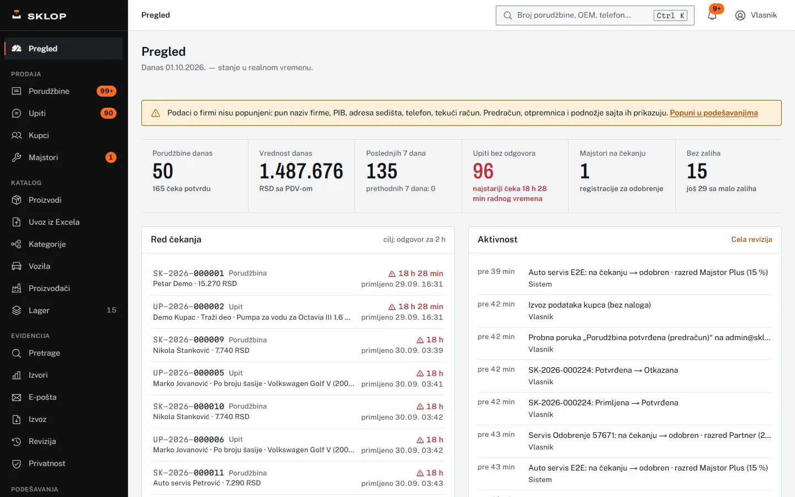

Žuta traka na vrhu znači da podaci o firmi nisu uneti; ista traka se vidi na predračunu i otpremnici (ne štampa se). Kartica „Upiti bez odgovora“ pokazuje koliko upita čeka i koliko dugo, računajući samo radno vreme. „Red čekanja“ je spisak onoga što treba uraditi sada, najstarije prvo.

### 2.3 Prvo podešavanje (jednom)

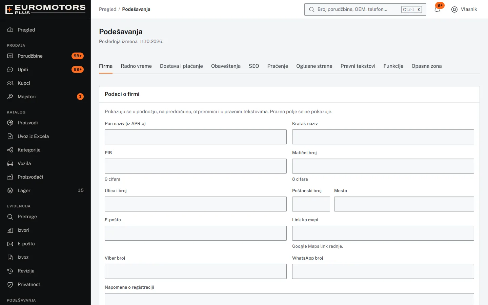

1. **Podešavanja → Firma:** pun naziv, PIB, matični broj, adresa sedišta i radnje, telefon, Viber, WhatsApp, e-pošta, tekući račun. PIB, matični broj i račun se proveravaju kontrolnom cifrom. Ovi podaci idu u podnožje sajta, u mejlove, na predračun i otpremnicu.
2. **Radno vreme:** dani, sati i neradni dani. Podsetnici za neodgovorene porudžbine i upite računaju samo radno vreme.
3. **Dostava i plaćanje:** cene dostave i prag za besplatnu dostavu, koji načini plaćanja su uključeni, linkovi za praćenje pošiljke po kurirskoj službi.
4. **Prodaja:** prag „malo na stanju“, rok „po porudžbini“, rok za slanje istog dana (prazno = rečenica se ne prikazuje).
5. **Obaveštenja:** adrese osoblja, sat dnevnog pregleda, režim slanja e-pošte ([§6](#6-obaveštenja)).
6. **Korisnici → Pozovi zaposlenog:** upišite e-poštu zaposlenog, kopirajte link i pošaljite mu ga (Viber, SMS). Link važi 7 dana i samo za tu adresu.

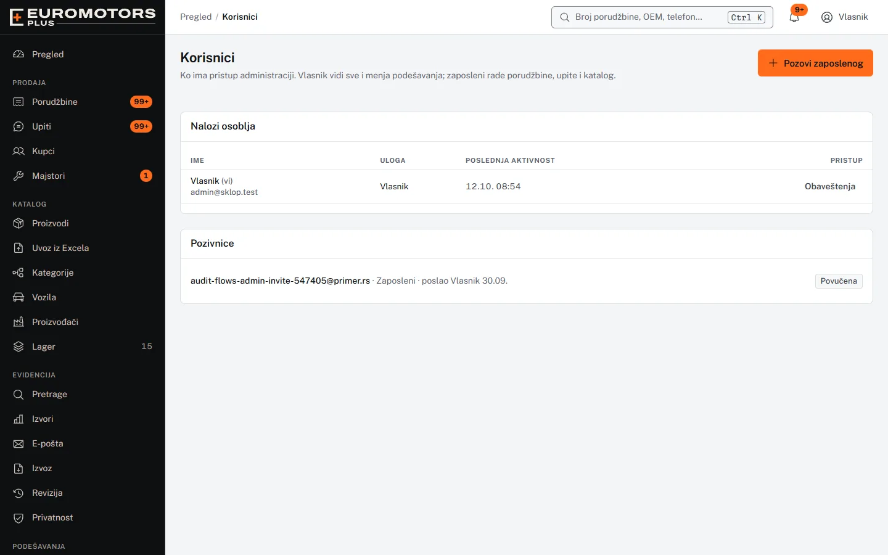

### 2.4 Svakodnevni rad

- **Nova porudžbina:** zvonce + mejl (kad je povezan Resend). Otvorite je iz zvonceta ili iz Porudžbine → kartica „Nove“. Tok je u [§4](#4-tok-porudžbine).
- **Novi upit:** isto, u Upiti. Tok je u [§5](#5-tok-upita-i-ponude).
- **Novi majstor:** Majstori → „Na čekanju“. Tok je u [§7](#7-majstori-i-rabat).
- **Artikal:** Proizvodi → „Novi artikal“ ili klik na red. Obavezni su naziv, kategorija, cena i stanje; kataloški brojevi se upisuju kako god stoje na kutiji, sistem ih sam normalizuje i pokaže kako će ih čitati. Slike se prevlače mišem i redosled se menja prevlačenjem.
- **Grupna izmena:** u Proizvodi označite redove → „Grupne radnje“ (cena u procentima, aktivno/neaktivno, kategorija). Posle izmene je dostupno „Poništi“.
- **Lager:** Lager → „Bez zaliha“ i „Malo na stanju“. Svaka promena stanja (porudžbina, otkazivanje, uvoz, ručna izmena) ostaje zapisana sa razlogom.

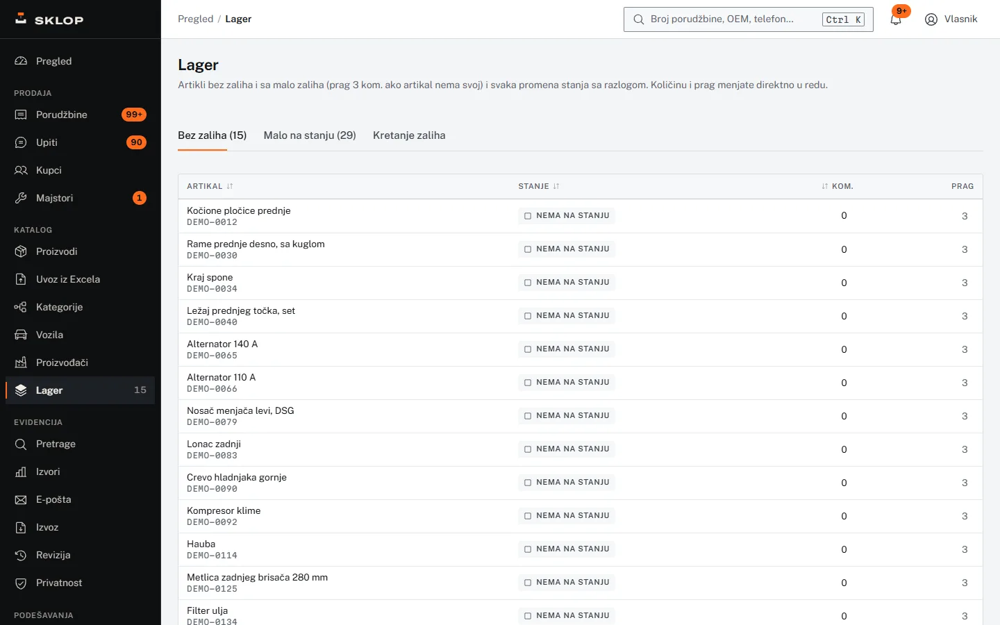

- **Traženo, a nemamo:** Pretrage → tabela „Traženo, a nemamo“. To je spisak delova koje kupci traže, a vi ih nemate u katalogu.

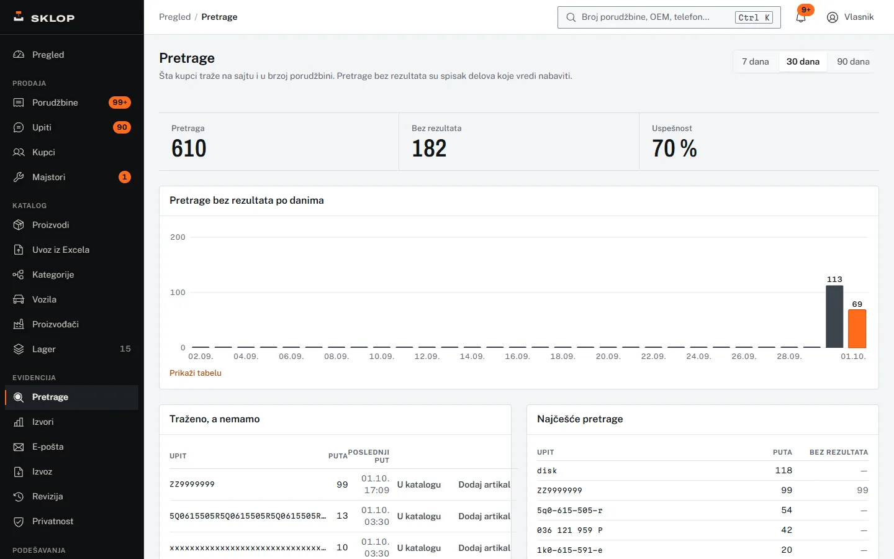

- **Kategorije:** stablo levo, desno SEO tekst za stranu kategorije, slika i deo 3D auta na koji kategorija reaguje.

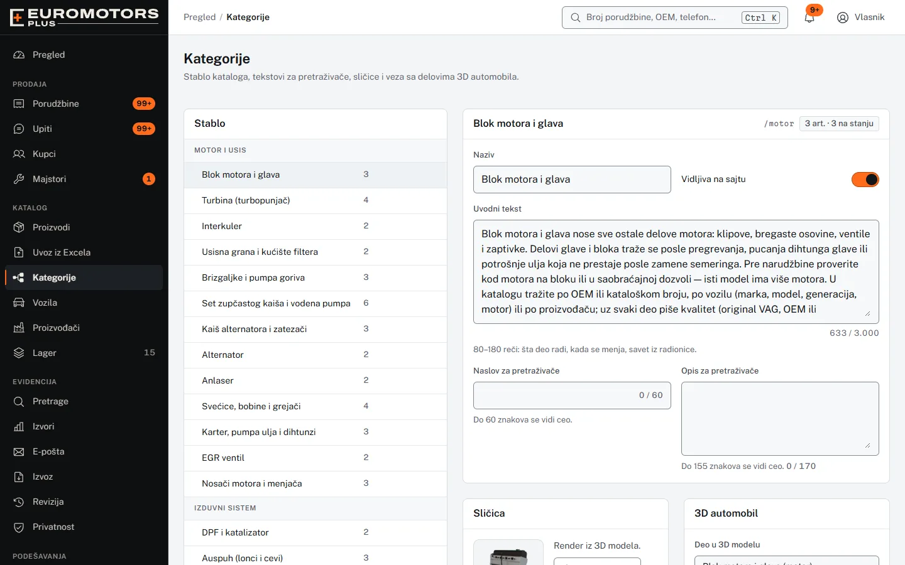

### 2.5 Prečice

`Ctrl K` pretraga i komande · `/` pretraga na stranici · `g` pa slovo stavke menija (npr. idi na porudžbine) · `n` pa `a` novi artikal · strelice gore/dole po redovima tabele, `Enter` otvara red, razmak označava red za grupne radnje. Ceo spisak otvara `?`.

---

## 3. Uvoz iz Excela

Uvoz čita ono što vaš knjigovodstveni program izveze: `.xlsx`, `.xls` ili `.csv` (i stari Windows-1250 CSV sa č, ć, ž, š, đ), do 25 MB i 50.000 redova.

1. **Admin → Uvoz iz Excela → „Šablon (.xlsx)“** ako hoćete prazan šablon sa uputstvom, spiskom kategorija, proizvođača i vozila. Ako koristite izvoz iz programa, šablon nije potreban.
2. **Datoteka:** prevucite fajl. Sistem nađe list i red sa zaglavljem (može i ispod naslova) i pokaže prvih nekoliko redova.

   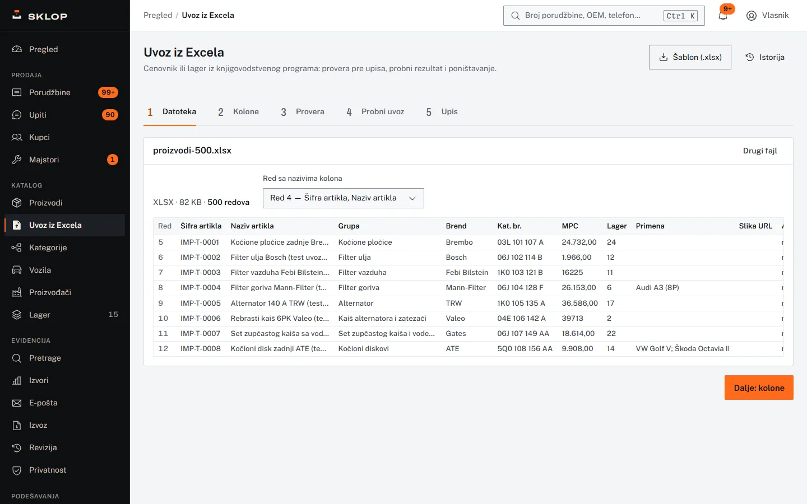

3. **Kolone:** kolone se same povezuju po nazivu („Šifra artikla“, „Kat. br.“, „MPC“, „Lager“…, i na engleskom). Proverite i po potrebi promenite. Izaberite režim:
   - **Pun uvoz:** pravi nove artikle i menja postojeće (po šifri).
   - **Samo stanje i cene:** menja samo količinu i cenu postojećih artikala; ništa novo ne pravi.

   Kliknite „Sačuvaj mapiranje“ i sledeći put se kolone povežu same.

   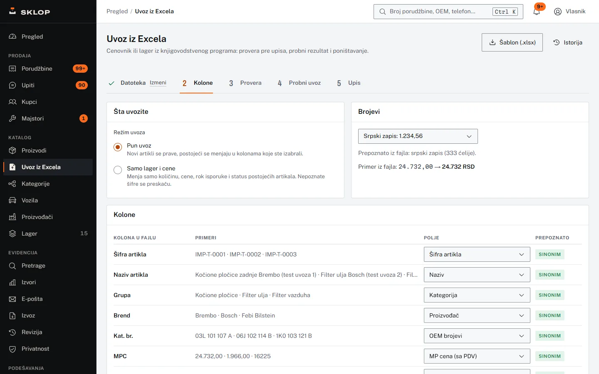

4. **Provera:** greške i upozorenja po redu (nema cene, nepoznata kategorija, negativno stanje…). Nepoznate kategorije iz programa povežete jednom za ceo fajl; nepoznate proizvođače napravite ili povežete. Spisak problema se preuzima kao `.xlsx`.

   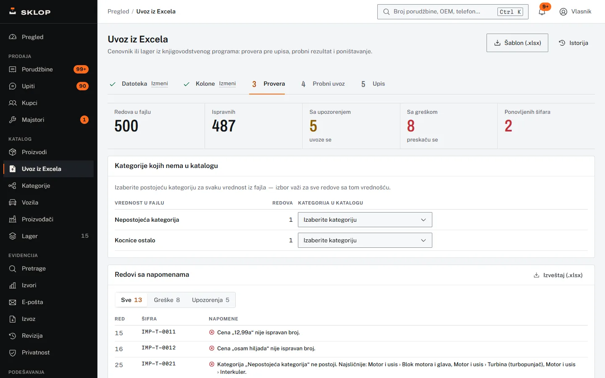

5. **Probni uvoz:** server pokaže tačno šta će se desiti: koliko novih, izmenjenih, nepromenjenih, preskočenih i grešaka, sa primerima „pre → posle“. Ništa još nije upisano.
6. **Upis:** upis ide u delovima, sa trakom napretka. Može da se zatvori stranica i vrati kasnije.
7. **Poništavanje:** Uvoz → Istorija → uvoz → „Poništi uvoz“ vraća stare vrednosti, briše artikle koje je uvoz napravio (ako ih niko nije menjao ili poručio) i preskače artikle koje je neko menjao posle uvoza.

Dodatno:

- **Deaktiviranje artikala kojih nema u fajlu** koristite samo sa punim cenovnikom. Traži da upišete reč `DEAKTIVIRAJ` i može da se poništi.
- **Cena u fajlu:** ako program izvozi samo veleprodajnu cenu bez PDV-a, uvoz računa maloprodajnu kao VP × 1,2 i to prikazuje kao upozorenje.
- **Slike sa adresa** (kolona sa URL-om slike) se preuzimaju posle upisa, samo za artikle koji još nemaju slike.
- **Ručni unos** jedan po jedan: Proizvodi → „Novi artikal“. Provere su iste kao kod uvoza.
- **Izvoz:** Admin → Izvoz: artikli u `.xlsx` (isti format kao šablon, može da se izmeni i vrati uvozom), porudžbine, kupci i majstori u `.csv`.

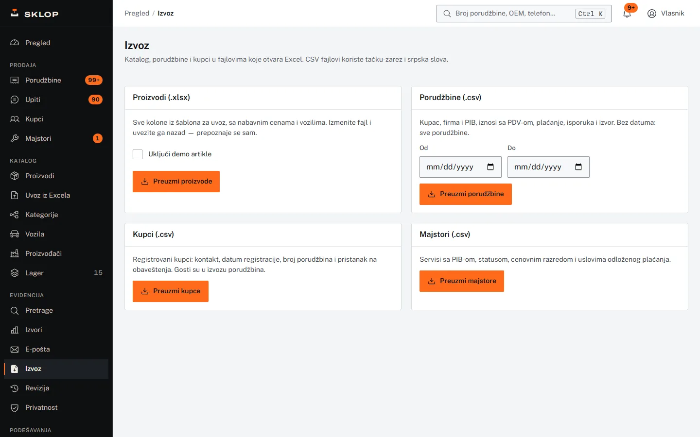

---

## 4. Tok porudžbine

```
nova → potvrđena → spremna za preuzimanje → preuzeta  → završena
                 ↘ poslata                → isporučena ↗
otkazana (iz svakog otvorenog stanja) · čeka deo (deo se naručuje)
```

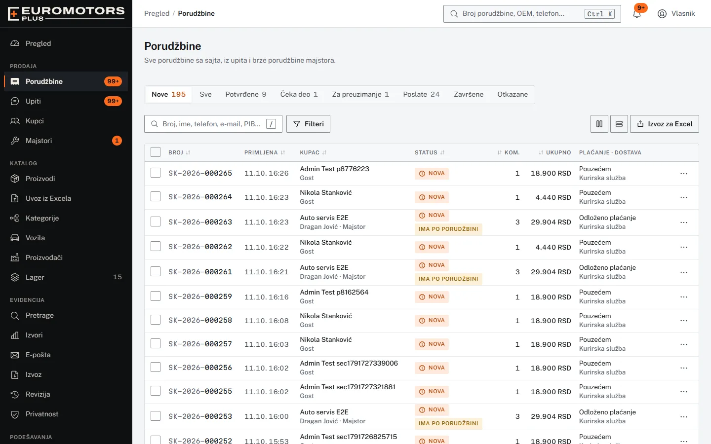

1. **Kupac poruči.** Porudžbina dobija broj `SK-2026-000123` i status „nova“. Kupac dobija mejl „Porudžbina je primljena“, osoblje zvonce i mejl.
2. **Proverite i potvrdite.** Otvorite porudžbinu. Pre potvrde možete da izmenite stavke („Izmeni stavke“), npr. kad je kupac tražio pogrešan deo. Kliknite **Potvrdi**. Tada se stanje umanjuje, a kupac dobija mejl „Porudžbina je potvrđena“ (sa podacima za uplatu kad plaća po predračunu).

   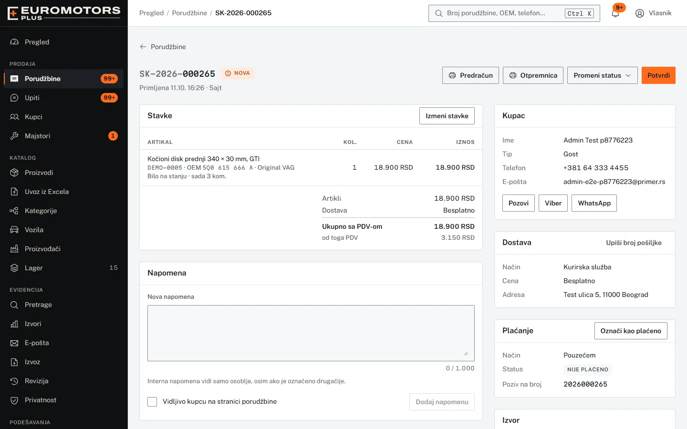

3. **Pripremite.**
   - Lično preuzimanje: **Promeni status → Spremna za preuzimanje**, kupac dobija mejl da može da dođe.
   - Kurir: **Upiši broj pošiljke**, izaberite kurirsku službu, pa **Označi kao poslato**. Kupac dobija mejl sa brojem pošiljke (i linkom za praćenje kad unesete linkove kurira u podešavanjima).
4. **Završetak.** **Označi kao preuzeto** ili **Označi kao isporučeno**. Kada novac stigne, **Označi kao plaćeno**. Porudžbina se sama zatvara 15 dana posle isporuke (podesivo).
5. **Otkazivanje.** Promeni status → Otkaži, sa razlogom. Stanje se vraća tačno onoliko koliko je uzeto, kupac dobija mejl.
6. **Štampa.** Dugmad **Predračun** i **Otpremnica** otvaraju verziju za štampu (A4). Više otpremnica odjednom: označite porudžbine u listi.

Uz svaku porudžbinu se vidi i odakle je kupac došao (oglas, kampanja, ključna reč), interne napomene (kupac vidi samo one označene „Vidljivo kupcu“) i cela istorija promena.

---

## 5. Tok upita i ponude

```
nov → u obradi → ponuda poslata → prihvaćena (→ porudžbina) | odbijena | istekla
```

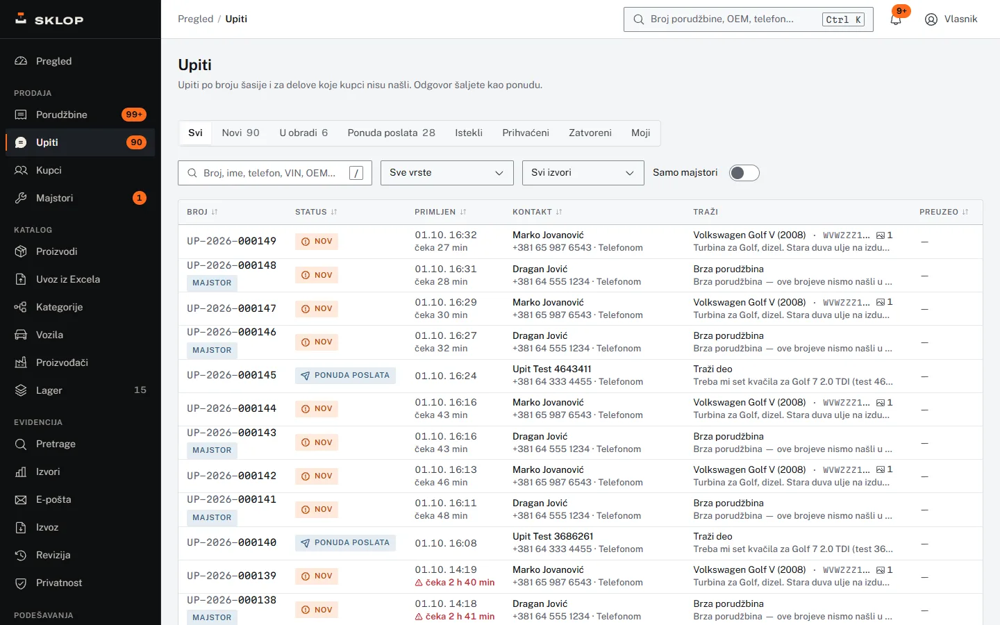

1. **Kupac pošalje upit** sa `/upit`, iz pretrage bez rezultata ili sa strane artikla. Upit dobija broj `UP-2026-000045`. Kupac dobija mejl, osoblje zvonce i mejl. Upiti majstora su označeni i idu prvi.
2. **Preuzmite upit** (status „u obradi“) da kolege vide da radite na njemu.
3. **Napravite ponudu:** stavke iz kataloga (pretraga po broju ili nazivu) ili slobodne stavke, sa cenom, rokom isporuke i napomenom; važenje ponude (podrazumevano 7 dana). „Sačuvaj nacrt“ ako niste gotovi, **Pošalji ponudu** kad jeste.

   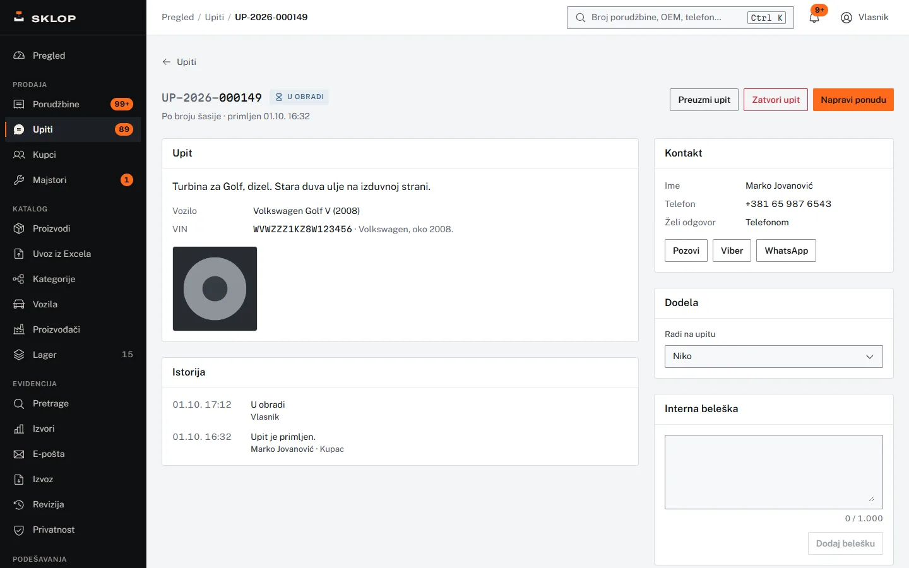

4. **Kupac dobija mejl „Ponuda je spremna“** sa linkom. Na toj strani prihvata ponudu (postaje porudžbina sa tim cenama), odbija je ili traži novu. Dan pre isteka dobija podsetnik.

   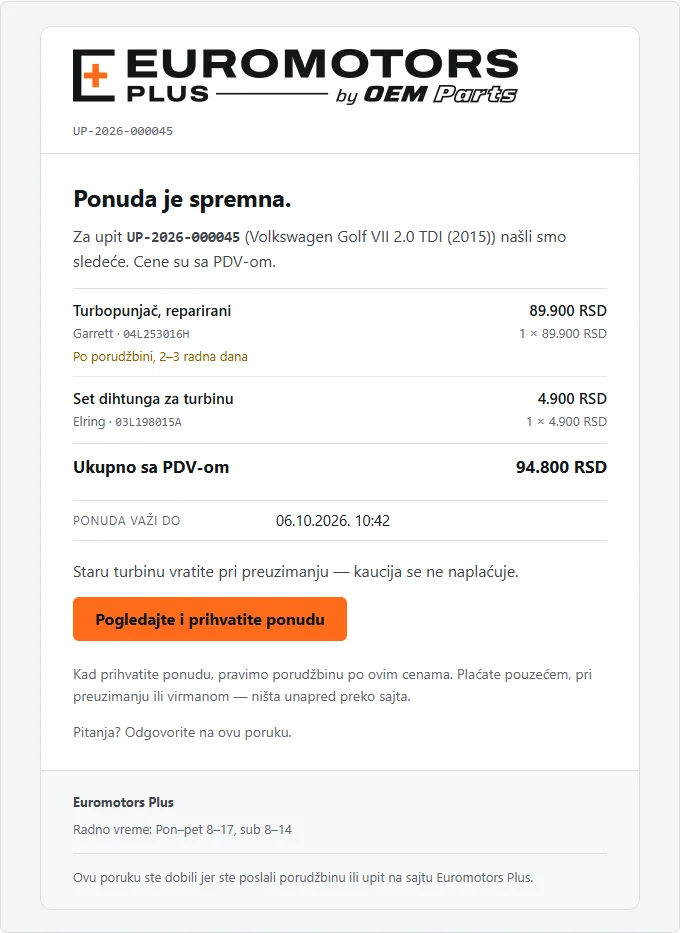

5. **Kupac bez e-pošte** (pitao telefonom ili Viberom): posle slanja ponude pojavi se „Link za kupca“ sa dugmićima za Viber, WhatsApp i SMS; link mu pošaljete vi. Kad kupac prihvati telefonom, kliknite **Pretvori u porudžbinu**.

---

## 6. Obaveštenja

Svaki događaj (nova porudžbina, promena statusa, upit, ponuda, registracija majstora, malo zaliha) ide kroz isti red: u zvonce u adminu odmah, i kao mejl ako je primalac tako izabrao.

**Kupci dobijaju mejl** za: porudžbinu primljenu, potvrđenu, spremnu, poslatu, isporučenu i otkazanu; upit primljen; ponudu spremnu (i podsetnik pred istek); „deo je stigao“; registraciju majstora primljenu, odobrenu i odbijenu; novu lozinku. Ukupno 25 šablona na srpskom, svaki i kao običan tekst, sa podacima firme iz podešavanja.

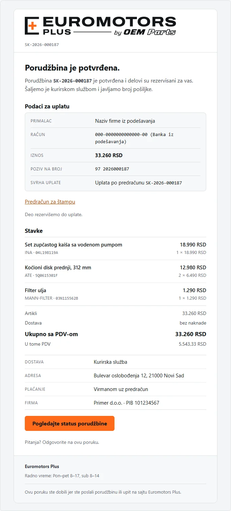

**Osoblje dobija:** mejl i zvonce za novu porudžbinu, upit, registraciju majstora i malo zaliha; dnevni pregled u 08:00; podsetnik za porudžbine i upite bez odgovora (prvi posle 120 minuta radnog vremena, drugi 2 sata kasnije). Svaki zaposleni bira šta dobija u Podešavanja → Obaveštenja.

**Režimi slanja** (Podešavanja → Obaveštenja → Slanje e-pošte):

| Režim | Šta radi |
|---|---|
| **Samo zapis** (sada) | Poruke se prave i vide u Admin → E-pošta, ništa ne odlazi. |
| **Test** | Sve ide na probnu adresu Resend-a, ne pravim ljudima. Za proveru izgleda. |
| **Uživo** | Pravi mejlovi kupcima i osoblju. |

Ako nedostaje Resend ključ ili adresa pošiljaoca, sajt sam ostaje na „Samo zapis“ i to piše u podešavanjima. Demo porudžbine i upiti se nikad ne šalju. Neisporučeni mejlovi se ponavljaju 5 puta (1 min, 5 min, 30 min, 2 h, 12 h); odbijene adrese se vide u zvoncu i u istoriji porudžbine. U **E-pošta** svaka poruka ima „Pošalji ponovo“; u **E-pošta → Šabloni** svaki šablon može da se pogleda kao na računaru, telefonu ili kao tekst, i pošalje kao probna poruka.

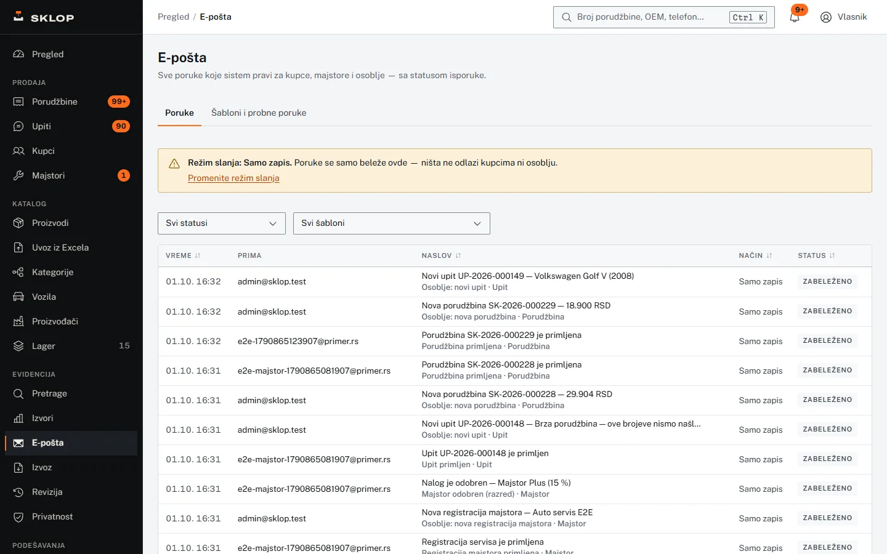

Viber i WhatsApp su linkovi „klikni i piši“ (sa brojem porudžbine u poruci), bez plaćenih servisa. SMS i Telegram nisu deo prve verzije.

---

## 7. Majstori i rabat

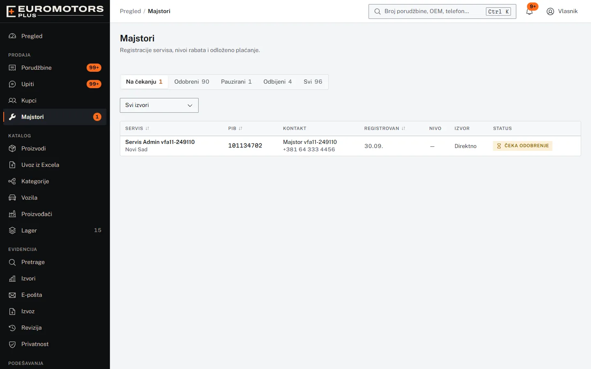

**Registracija.** Servis popuni `/za-majstore/registracija`: firma, PIB, matični broj, kontakt osoba, telefon, e-pošta, grad, adresa, vrsta servisa, marke. Nalog je „na čekanju“, osoblje dobija zvonce i mejl, servis vidi stranu „čeka odobrenje“.

**Odobrenje** (Majstori → servis):

1. Proverite firmu (PIB i matični broj su već provereni kontrolnom cifrom).
2. Izaberite **nivo rabata**: Majstor 10 %, Majstor Plus 15 %, Partner 20 % (procenti se menjaju u Cenovni razredi).
3. Po potrebi: lični rabat, izuzeci po kategoriji ili proizvođaču (npr. 25 % na diskove), **odloženo plaćanje** sa limitom i rokom (prazan limit = bez limita).
4. **Odobri nalog.** Servis dobija mejl i od tada vidi svoje cene. Odbijanje traži razlog; nalog može i da se suspenduje i ponovo aktivira.

**Kako se računa cena.** Na serveru, za svaki artikal: osnovni rabat nivoa → izuzetak po kategoriji ili proizvođaču → lični rabat. Cena nikad ne ide ispod nabavne cene uvećane za minimalnu maržu (podrazumevano 8 %), kad je nabavna cena poznata. Majstor vidi maloprodajnu cenu precrtanu i „Vaša cena“ ispod. Njegova cena se ne vidi drugim kupcima, ne ulazi u keš stranica ni u izvorni kod strane.

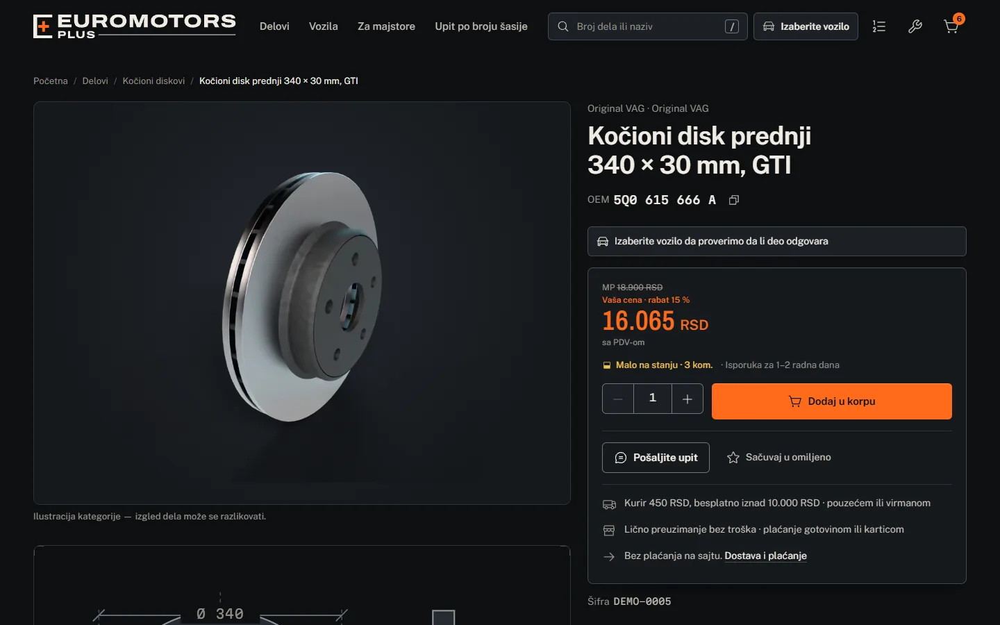

**Šta majstor ima u portalu** (`/majstor`):

- **Brza porudžbina:** nalepi redove kao `1K0615301AA 2` ili učita CSV. Svaki red dobija „tačno“, „više opcija“ (bira proizvođača) ili „nije pronađeno“. Jedno dugme dodaje sve u korpu, drugo šalje nepronađene brojeve kao upit.

  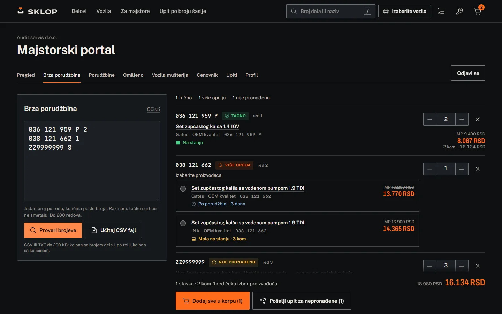

- Istorija porudžbina sa „Poruči ponovo“, omiljeni artikli, vozila mušterija (VIN, tablice, napomena), cenovnik po izabranim kategorijama u Excelu, profil i upiti.
- **Odloženo plaćanje** se nudi na porudžbini samo ako ste ga uključili, sa preostalim limitom. Porudžbina preko limita se odbija.

Zaposleni koji je i majstor ne može sam sebi da odobri profil niti da menja svoj rabat; to radi vlasnik.

---

## 8. Šta je privremeno

| Šta | Gde se menja |
|---|---|
| **Naziv i znak** | Sajt nosi naziv „Euromotors Plus“ i znak „Euromotors Plus by OEM Parts“ (koraci 24 i 25). Naziv i poznati naziv radnje: Podešavanja → Firma; pravila pisanja: `lib/domain/brand.ts`. Znak je crtež: menja se u `scripts/brand/logo/logo.mjs`, pa `node scripts/brand/logo/build.mjs` i `node scripts/brand/logo/site.mjs`. Čeka se odobrenje klijenta (GO-LIVE §A). |
| **Demo artikli** `DEMO-0001`…`DEMO-0150` i zamene `DEMO-E001`…`DEMO-E007` (izmišljeni kataloški brojevi, označeni „VAG (demo)“), demo majstor, 8 demo porudžbina, 4 demo upita | [§9](#9-brisanje-demo-podataka) |
| **Probni zapisi iz automatskih testova** na razvojnoj bazi (porudžbine i upiti od „Admin Test…“, „Auto servis E2E“, adrese `@primer.rs`) | Ostaju na razvojnoj bazi. Produkciona baza počinje prazna, pa ih tamo nema. |
| **Demo oglasna strana** `/ponuda/kocione-plocice-golf` | Podešavanja → Oglasne strane |
| **Podaci firme, kontakt, radno vreme, tekući račun** | Prazni; sajt ih ne prikazuje dok se ne unesu (Podešavanja → Firma). |
| **Pravni tekstovi** | Šabloni po srpskim zakonima, označeni „potreban pravni pregled“ (Podešavanja → Pravni tekstovi). |
| **O nama, Kontakt i pravne strane** | Opšti tekstovi bez izmišljenih podataka; menjaju se u Podešavanja → Pravni tekstovi (Markdown sa pregledom). |
| **Česta pitanja** (početna, dostava, za majstore) | Admin još nema ekran za njih: izmenu radi programer u `convex/seedData/content.ts` i pušta je skriptom. Dodavanje tog ekrana je mala dorada (vidi GO-LIVE §D). |
| **Pravila prodaje** (dostava 450 RSD, besplatno preko 10.000 RSD; rabat 10/15/20 %; marža 8 %; važenje ponude 7 dana; prag zaliha 3 kom.) | Podešavanja i Cenovni razredi. Potvrditi sa klijentom (GO-LIVE §B). |
| **Mejlovi** u režimu „Samo zapis“ | Posle povezivanja Resend-a (GO-LIVE §5). |
| **GA4, Google Ads, Meta** | Polja prazna, nijedan kod se ne učitava (Podešavanja → Praćenje). |
| **Slike artikala** | Do pravih fotografija koriste se renderi kategorija iz 3D modela. |
| **Podaci o vozilima** (godine, VIN kodovi, kodovi motora) | Uneti po opšte poznatim podacima, označeni „seed – proveriti“ (Admin → Vozila). |
| **Linkovi za praćenje pošiljke** | Prazni dok se ne potvrde (Podešavanja → Dostava i plaćanje). |

---

## 9. Brisanje demo podataka

Pre objave, i najkasnije pre prebacivanja mejlova na „Uživo“:

1. Napravite rezervnu kopiju baze ([`BACKUPS.md`](BACKUPS.md) §1).
2. Prijavite se kao **vlasnik** (zaposleni ne vide ovu opciju).
3. **Admin → Podešavanja → Opasna zona → „Obriši demo podatke“.** Pokazuje koliko artikala, porudžbina, upita i naloga je označeno kao demo.
4. Upišite potvrdu `OBRIŠI DEMO` i potvrdite. Brisanje ide u delovima i ne dira ništa što nije označeno kao demo (pravi artikli, porudžbine, podešavanja, kategorije i vozila ostaju).
5. Posebno obrišite ili izmenite demo oglasnu stranu u Podešavanja → Oglasne strane.

Na produkciji je jednostavnije: nova baza se napuni referentnim podacima i demo artiklima (`seed:run`), proveri se da sve radi, pa se demo podaci obrišu ovim dugmetom. Postupak je u GO-LIVE §3.

---

## 10. Demo za klijenta: redosled

Otvorite [`showcase/index.html`](showcase/index.html) za pregled sa snimcima, ili pokrenite sajt lokalno (README → Setup) i idite ovim redom (oko 15 minuta):

1. **Početna:** skrolujte da se auto rasklopi, kliknite na turbinu, pokažite panel sa cenom i stanjem. Dugme „Lista delova“ za istu stvar bez 3D-a.
2. **Pretraga:** u polje upišite `5q0-615-666-a` (namerno sa crticama i malim slovima), pokažite da nađe disk.
3. **Kategorija** `/delovi/kocioni-diskovi`: izaberite vozilo (Volkswagen → Golf → Golf VII), filteri se suze.
4. **Artikal → Dodaj u korpu → Porudžbina:** prođite korake do pregleda (bez plaćanja na sajtu).
5. **Upit** `/upit`: upišite broj šasije `WVWZZZ1KZ8W123456`, sistem prepozna marku i godinu.
6. **Majstor:** odjavite se, prijavite kao demo majstor, pokažite „Vaša cena“ na istom artiklu i brzu porudžbinu sa spiskom brojeva.
7. **Admin:** pregled, jedna porudžbina (Potvrdi → mejl u E-pošta), jedan upit sa ponudom, uvoz iz Excela do koraka „Provera“ (fajl `tests/fixtures/import/proizvodi-500.xlsx`), E-pošta → Šabloni.
8. **Pre objave:** šta treba od klijenta (GO-LIVE §A).

Pristupni podaci za razvojnu bazu nisu u ovom dokumentu: vlasnik je u `pipeline/env/ADMIN-CREDENTIALS.txt` (nije u gitu), demo majstor i kupac iz testova u `.playwright/audit-accounts.json`.
